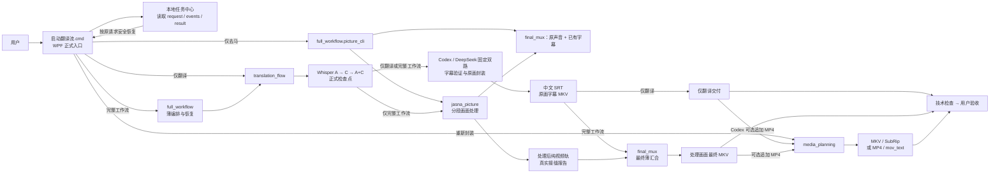
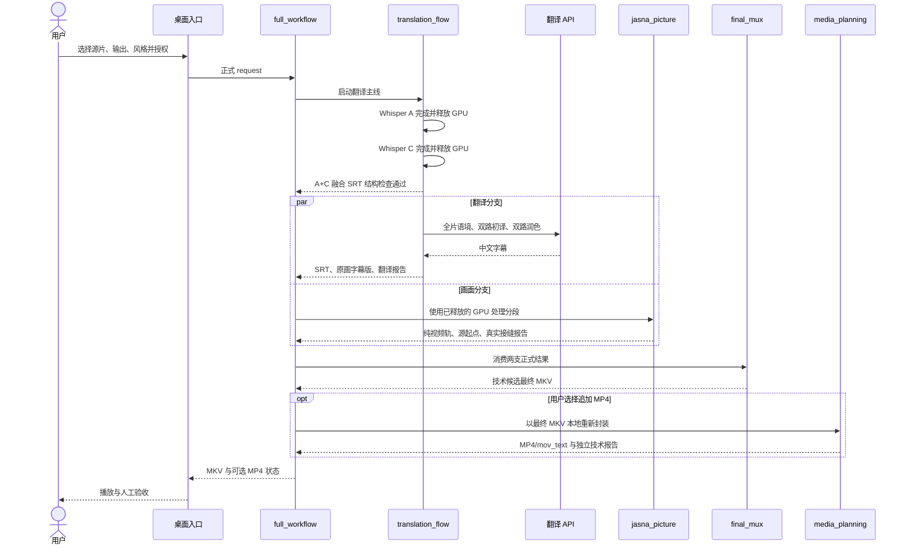

# PROJECT_BRIEF｜自动字幕与画面处理工作流

> 本文件是统一的项目架构与技术路线说明，可直接用于外部架构讨论。影片编号、字幕文本、任务 ID、本机媒体路径和密钥信息不进入本文。

### 源码目录（2026-10-14）

对外源码按用途收在五个目录：`src/` 保存桌面与 Python 模块，`scripts/` 保存安装及命令行脚本，`tests/` 保存全部离线测试（画面测试在 `tests/picture/`），`config/` 保存配置样例，`docs/` 保存展示图片。根目录的 `启动翻译流.cmd` 仍是用户入口。

Python 模块名保持不变。桌面入口和 `scripts/python.cmd` 为子进程配置当前源码的 `src` 路径；本机配置、工具、输出和队列仍按仓库根目录定位，工具默认放在被忽略的 `workflow/tools/`。此目录整理用于对外源码，未部署到本机冻结版本。

### 源码公开（2026-10-14）

公开地址为 [escaper74/translation-flow-open](https://github.com/escaper74/translation-flow-open)。用户已批准新建独立公开仓库；原开发仓库继续私有，旧 `main` 的开发历史不进入公开仓库。对外版本包含源码、界面图片、启动和安装脚本、测试、配置样例、许可证及使用说明；模型、工具安装包、账号凭据、本机配置和用户媒体不随源码发布。源码完整性已通过远端文件树和匿名 ZIP 下载比对，新机器仍需按 README 与 WORKFLOW 安装运行组件。

### 当前冻结基线（2026-10-04）

用户已认可当前版本，并授权 00 固化为本地标签 `v1-desktop-accepted-20261004`。本次包含正式桌面的 Turbo 默认/large-v3 可选、开头局部校时、阶段计时、成品清理入口及对应回归；不新增功能、不重跑真实媒体，也不追溯改写旧任务结果。下文各日期的“尚未提交/尚未合入”描述仅代表当时状态；当前交付以此冻结标签及正式入口为准。

00 继续负责主目录整合与发布决定。03 负责从该基线准备新机器安装、对外说明、许可证及源码脱敏检查。用户已于 2026-10-04 确认采用 Apache-2.0，并确认首页插图由本项目生成；对外准备不含开发 Git 历史的源码快照。这个标签是已认可的本地功能基线，不表示已经上传或完成开源发布。

## 0. 二次熟悉时先记住这四件事

1. 当前正式界面按用户确认的 A 方向：首页为 **去马、翻译、美颜** 三张卡片。前两项直接选择视频，下一页仍可独立或双选去马与翻译，设置保存位置及 MKV/MP4；翻译仍兼容 SRT。美颜直接打开独立播放器。模型、本地工具及已有字幕视频换格式收在右上角设置。
   视频字幕、SRT 与双选任务沿用 **Codex、DeepSeek、Qwen、Kimi、OpenAI、Anthropic、Gemini** 已有后端，不因双选更换服务或模型。
   仅去马通过 `full_workflow.picture_cli` 调用现役 Jasna，再用 `final_mux` 保留原声音与全部已有字幕，输出可播放成品；它不启动 ASR、不调用翻译、不要求登录或 Key。SRT 仅支持精修字幕，选择去马时说明当前输入不适用。
   正式入口支持本地字幕导入检查：内嵌中文轨、匹配文件名的外挂字幕、Windows 中文 OCR 的烧录字幕抽样；发现已有中文字幕便跳过该文件的翻译。去马始终由用户勾选，不自动识别去马痕迹。
2. 完整工作流长期保持“翻译主线”和“画面主线”解耦；A+C 检查点完成后，两支才并行，最后只汇合一次。
3. `full_workflow` 只负责编排和恢复，不复制翻译、画面或封装算法；各模块以正式报告交接。
4. 机器通过只代表技术候选；翻译、画面、同步和播放体验仍由用户验收，结论另写 `human-review.json`。

推荐复习顺序：先看本文第 2 节总图和第 3 节技术路线；需要实际投片、恢复或排错时，再看 `WORKFLOW.md` 第 1–5 节。合作和不可越过的边界只看 `AGENTS.md`。

### 当前产品增量：成品、校对与通知（2026-09-23）

- 顶部“成品”打开本地成品中心：从正式结果读取完整视频，完整工作流与其翻译子任务合并展示；默认优先显示已生成 MP4，其次 MKV，不把纯视频或分段当作成品。支持切换输出目录及查看直接子目录中的正式任务；没有正式记录的散落旧视频不自动归类。
- 每张视频成品卡的播放按钮下方提供“清理中间文件”，仅列该任务的大媒体检查点和逻辑大小。用户看过成片并确认精确路径、数量后才能永久删除；所有完整成片版本、源片、字幕、缓存和日志都保留。清理记录独立落盘，任务中心不再对已清理检查点的任务承诺原地恢复。不是自动删除，也不清理任意外部 ASR 临时目录。
- “字幕校对”并列日文参考和可编辑中文，点击行可定位内置播放器；视频播放依赖本机 Windows 解码支持。另存人工修订 SRT，不覆盖自动原稿；可用原成片视频/音轨 stream-copy 导出新的人工修订 MKV。多字幕轨或非中文轨不自动替换，独立 SRT 可只保存修订。
- 正式后台队列在成功或失败终态请求 Windows 通知，不包含影片名、路径或字幕。关窗后后台仍可发送；Windows 通知设置决定是否显示。通知失败不改变任务结果。
- 对应代码为 `src/translation_flow/library.py`、`src/desktop/TranslationFlowLibrary.ps1`、两个配套 XAML 和 `src/translation_flow/notifications.py`；不改识别、翻译模型、画面算法或既有缓存身份。
- 实时美颜作为独立播放层接入“首页 → 美颜”和“成品 → 美颜播放”，不混入翻译/画面生产任务。独立视频窗内的“美颜”打开可单独移动的小工具窗；关闭工具窗不停止播放、不清空强度，重开继续调节，关闭视频窗时工具窗一起关闭。磨皮、美白、瘦脸、大眼可边看边调或暂停调节；只改变观看画面，不覆盖原片、不生成整部美颜副本。短片预览/前后对比生产功能仍不做。
- A 版主窗口使用白底与青绿，首页三卡、任务进度卡和内嵌成品卡统一导航；服务、风格和格式以直接选项呈现。任务操作沿用原队列；成品保留播放、版本切换、字幕校对和精确清理确认。缩略图由本机 Windows Shell 异步读取，失败时显示插图，不阻塞界面。用户已确认前端验证完成并批准部署；2026-09-24 的实现提交 `e93a4c1` 已合入正式主目录的 `main`，入口仍为 `启动翻译流.cmd`。主目录回归 352 项中 337 通过、15 项环境跳过，画面独立回归 33 项通过；此次没有更改后端算法或运行真实影片。

验证边界：新增功能使用合成任务、真实 WPF 按钮及 CPU 生成短片验证；没有处理用户真实媒体或调用外部服务/GPU。用户的桌面观感、实际视频解码和系统通知显示仍需使用时确认。

### 实时美颜播放层（2026-09-23）

`beauty_player` 以 Python 标准库启动仅绑定 127.0.0.1、随机地址的单视频服务，WPF 通过现有进程桥打开独立 Edge 播放窗。它不需要登录、Key、字幕外发授权或新生产任务。页面只访问本机资源；跟踪使用本地 MediaPipe Tasks Vision 0.10.21/FaceLandmarker，变形 shader 改编自 GPUPixel，磨皮/肤色为本地 WebGL 实现，不引入未完整开源的 Mars-Face，也不宣称集成了完整 GPUPixel 引擎。

- 浏览器支持的 MP4 直接读源；常见 MKV 经 FFmpeg stream-copy 到内存管道播放，跳转以探测的真实关键帧为锚点，同步字幕和进度。
- 浏览器无法解码 HEVC 时，改用 FFmpeg CPU 实时生成 H.264 观看流（最高 1080p，音轨仍 copy），不保存视频副本。兼容播放会占用额外 CPU；它不是正式转码产物或美颜导出。
- 渲染最多 1080p/两张脸；未检测到稳定人脸显示原画，明显侧脸关闭瘦脸/大眼形变。中文字幕为单独显示层，不被拉伸；第一版播放第一条音轨、首选内嵌中文文本字幕，不做外挂字幕、多音轨选择、HDR 校色或导出。
- 独立 Edge 短片测试已覆盖 H.264/MP4、H.264/MKV 和 HEVC 兼容播放，真实加载模型，检查各滑块像素变化、关闭恢复原画、暂停、跳转和字幕开关。测试素材是公开人像生成的短片；静态人像测试不证明复杂运动/遮挡/多人镜头的美颜观感，也不代表用户观看验收。运行组件约 22 MiB，置于被 Git 忽略的工具目录；第三方来源及声明见 `src/beauty_player/THIRD_PARTY.txt`。
- 播放 UI 使用奶白、浅紫和葡萄紫；正常状态只显示“实时生效”，不显示人脸数、跟踪或帧率。工具窗为同源独立 popup，播放窗持有本次强度、校验消息来源并同步；弹窗被浏览器策略拦截时明确提示，不退回固定侧栏。视频随窗口自适应，也可只缩放画面（50%–200%），不缩放字幕、播放控件或工具栏；全屏保留播放控制。工具窗不是系统置顶窗口，实际系统窗口管理仍由 Edge/Windows 决定。

## 1. 目标与完成标准

用户投入一部真实日语影片，由正式桌面入口自动生成：

- 完整中文字幕 SRT；
- 保留原画与原音轨的中文字幕 MKV；
- 可选的画面处理后纯视频轨；
- 画面处理后、保留原音轨并带中文字幕的最终 MKV；
- Codex 原画字幕任务及完整工作流可在正式 MKV 通过后追加一份 MP4/mov_text 软字幕成品；
- 对已带中文字幕的影片，可独立生成 MKV 或 MP4 软字幕版；
- 可审计的阶段事件、检查点和技术报告，以及基于这些正式记录的本地任务中心。

机器负责结构、轨道、时长、可解码性和恢复证据；用户负责翻译自然度、画面质量、接缝、字幕/声音同步和整体观看体验。只有技术检查和用户观看都通过，才能写“最终通过”。

## 2. 当前架构

### 2.1 用户功能与正式运行路径



`media_planning` 是独立的本地重封装旁路，不经过 Whisper、翻译 API 或 Jasna。完整工作流则复用翻译和画面两个已独立成立的模块，并在最后一次性汇合。

### 2.2 完整工作流运行时序



关键点不是“同时启动得越早越好”，而是：A、C 都退出并形成可复用的正式融合检查点之后，翻译 API 和画面分支才并行。任一支失败，另一支继续保留成果；只有两支都通过才进入 `final_mux`。

### 2.3 模块职责与代码入口

| 模块 | 唯一职责 | 首要代码入口 | 正式交付 |
|---|---|---|---|
| 桌面 UI | 构造请求、取得当次授权、启动白名单后端、显示 JSONL 进度/运行摘要/本地任务中心 | `src/desktop/Start-TranslationFlow.ps1`、`src/desktop/TranslationFlowProcessBridge.ps1`、`src/desktop/TranslationFlowUiSummary.ps1`、`src/desktop/TranslationFlowTaskCenter.ps1` | 请求和用户可见状态；不拥有媒体算法 |
| `translation_flow` | A/C 识别、保守融合、外部翻译、字幕验证和原画封装 | `src/translation_flow/cli.py`、`src/translation_flow/runner.py` | 中文 SRT、字幕检查表、原画字幕 MKV、翻译报告 |
| `full_workflow.picture_cli` | 仅去马编排与可播放成品交付，不启动翻译 | `src/full_workflow/picture.py` | 去马 MKV/MP4、原声音、已有字幕和正式报告 |
| `jasna_picture` | 视频分段、Jasna 处理、段级验证、拼接和真实接缝测量 | `src/jasna_picture/cli.py`、`src/jasna_picture/workflow.py` | video-only MKV、画面报告 |
| `final_mux` | 按画面报告映射字幕和原音轨，一次性生成最终成片 | `src/final_mux/cli.py`、`src/final_mux/workflow.py` | 最终 MKV、封装报告 |
| `full_workflow` | 组织 A+C 后双分支、恢复、失败隔离和最终状态 | `src/full_workflow/cli.py`、`src/full_workflow/runner.py` | 顶层 manifest/result；不复制各模块算法 |
| `media_planning` | 按 FFprobe 实际流信息规划并执行已有中文字幕影片重封装 | `src/media_planning/cli.py`、`src/media_planning/runner.py` | MKV/MP4 软字幕版、技术报告 |
| `video_pipeline` | 保留早期画面路线代码，并提供少量共享工具定位能力 | 当前没有桌面正式运行模式 | 不应与 `jasna_picture` 混称为现役画面主线 |
| `workflow/tools` | 保存本机固定工具链 | 各 runner 通过正式配置定位 | FFmpeg、Whisper、Jasna 等本地可执行文件和模型资产 |
| 测试 | 离线契约、真实短媒体和画面独立回归 | `tests/`、`tests/picture/` | 能证明具体行为的回归证据 |

运行数据不写回代码目录：翻译、完整工作流和重新封装分别在输出目录的 `.translation-flow/<job-id>`、`.full-workflow/<job-id>`、`.media-repackage/<job-id>` 留下请求、事件、检查点和报告。正式大媒体产物与这些小型证据分开保存。

### 2.4 容易混淆但实际不同的边界

- `full_workflow` 是调度器，不是第四套翻译或媒体算法。
- `final_mux` 负责“处理后画面 + 原音轨 + 正式 SRT”的最终汇合；`media_planning` 负责“已有中文字幕影片”的容器重封装，两者不是同一路线。
- `video_pipeline` 含历史路线和共享工具定位代码；当前正式画面生产只走 `jasna_picture`，不要把 `scripts/run-video-processing.ps1` 当成第二条现役入口。
- A+C 的 A 是完整条目和时间轴主体，C 常规只提供保守文本候选；新任务在融合交接前可用 C 与本地 VAD 证据校正明确异常的开头前缀，保留原始 A，正文和其余时间不变。C 的数量更多不等于应该替换更多。
- 画面分段是恢复和接缝证据，不是自动提速机制。
- `technical_checks_passed` 只表示机器检查通过；`human-review.json` 才记录用户观看结论。
- 完整工作流追加 MP4 是最终 MKV 之后的交付层：MP4 失败只标记该交付失败，不推翻或删除已经通过的 MKV。
- canonical `main` 是正式事实；独立 worktree 的实现或测试在合入前不能冒充主线完成。
- 仓库里仍有可从 Git 恢复的旧说明和历史入口；长期有效的项目资料只有 `AGENTS.md`、`PROJECT_BRIEF.md`、`WORKFLOW.md`。

### 2.5 为什么保持两条主线解耦

- 翻译失败不破坏已经完成的画面段；画面失败不使 API、Whisper 和字幕成果失效。
- 画面主线只交付视频轨，不提前混入音频和字幕。
- 最终封装只有一个职责，时间映射只来自画面正式报告。
- 每条主线可以独立短样、恢复、技术验收和用户验收。

## 3. 冻结的 V1 技术路线

### 3.1 翻译主线

```text
本地预检
→ Whisper A：完整时间轴骨架
→ A 退出并释放 GPU
→ Whisper C：候选文本
→ C 退出并释放 GPU
→ A+C：只接受唯一、可靠的一对一替换
→ 开头局部校时：证据明确才修改，正文及其余时间保持
→ 融合 SRT 再次通过正式结构检查
→ 与画面主线分叉并行
→ 全片语境
→ 固定前后两路分批初译
→ 全部初译验证
→ 固定前后两路第二轮润色
→ 必要时一次假名残留修复
→ 字幕结构硬门
→ 原画/原音轨中文字幕 MKV
```

固定原则：

- A 保留完整条目骨架；C 不删除 A，常规只做保守文本替换。仅新任务允许已验收的开头局部校时规则，原识别时间保留在 `A.recognized.ja.srt`，正式 `A.ja.srt` 与 fusion/翻译继续保持一致；旧检查点不追溯改写。
- 不同翻译风格、供应商、模型和源字幕使用独立缓存身份。
- API Key 只在当次进程内使用，不写入请求、缓存、日志、报告或 Git。
- 外部服务只接收字幕文本，音频和视频留在本机。
- 初译和润色各自固定分为连续前后两路，并发为 2；两路不抢批次，润色必须等待全部初译完成。
- 每条字幕必须满足 ID 连续、文本非空且 `end_ms > start_ms`。
- 翻译成功批次立即落盘；同一正式任务只补缺失批。
- 正式字幕、MKV 和技术报告不覆盖已有文件。

### 3.1.1 Codex 字幕接入

新本机任务默认推荐 Codex，使用官方 `codex exec` 与已有 ChatGPT 登录。适配器不读取认证文件、不改变登录或全局配置，不使用私有协议或 API Key 回退。请求身份固定为 `codex / chatgpt.com / cli-default`；`cli-default` 表示不指定 `--model`，实际模型若 CLI 未报告则保持未知。已有 DeepSeek 请求、模型和缓存身份保留。Codex 同时支持仅字幕和双选，桌面保留所选服务与模型。

`translation_flow.translation.codex_provider.CodexProvider` 实现已有 `TranslationProvider.chat(...)` 接口；`codex_runner` 仅编排已有 A+C、独立源文审查、`run_translation` 和封装服务。ID、时间轴、分批和缓存仍由程序控制。CLI 在空临时目录、只读沙箱、忽略用户配置、禁止工具和网页搜索的条件下接收字幕文本；字幕内的命令按引用数据处理。输出正文为 `items[].id/text`，额外 `note` 只进入检查表和审查报告。调用记录只保留版本、模型策略、耗时及 CLI 返回的 usage 等元数据。

源文层保留 A、C、fusion 原件，另写 `reviewed.ja.srt`。先比对 C 的短词重复与重叠 A 文本：样本至少 100 条、同一不超过 4 字符短词占 C 至少 60%、A 支持比例不超过 20% 时，独立参考保守采用 A 全文并报告退化；频繁且受 A 支持的应答不触发降级。正常情况下审计全部 accepted 替换，完全相同及纯格式差异机械记录，其余每批最多 40 条文本复核；疑点进入人工清单，不因此阻止候选交付。不自动扩展音频复听或重跑 ASR，也不把文本判断称为听音确认。

Codex 缓存独立包含适配器/CLI 版本、模型策略、提示、源文本和翻译风格。成功初译、润色及假名修复批次立即落盘。登录失效、额度限制和取消直接停止，无付费 API 回退；连接/输出失败有限重试，本地持久化失败不重复发出调用。ASR 期间停止以约 0.2 秒间隔检查取消并终止本任务拥有的转录子进程树，不等待整个 A/C 阶段；A 的已完成分块保留，被打断分块带未完成标记，恢复时重算，不能仅凭非空字幕复用。CLI 期间停止只终止本任务拥有的 CLI 子进程。完成的 SRT/报告与 MKV 匹配时，恢复或追加 MP4 不再调用 Codex、ASR 或画面服务。

2026-09-12 接入在独立实现分支完成官方 CLI 小样、真实桌面登录状态及 8 秒合成双音轨媒体验证，停止后仅补缺失批次，完成后可追加和复用 MP4。ASR 输入在该合成测试中是明确生成的检查点夹具，不代表新版正式入口已完成真实整片或真人观看验收。00 已将三个 Codex 提交与六家 API 扩展整合进 canonical；正式目录主回归共 197 项，187 通过、10 项按环境跳过，入口校验与编译通过。上述真实小样仍标注为原独立分支证据，后续正常投片与用户观看待验。

### 3.2 画面主线

当前冻结路线：

| 项目 | V1 设置 |
|---|---|
| 工具 | Jasna v0.10.0 |
| 检测 | `lada-yolo-v4` TensorRT，batch 4 |
| 修复 | BasicVSR++ TensorRT、FP16、clip 90、overlap 8、crossfade |
| 解码 | 必须是 VALI NVDEC 或 PyAV CUDA，软件回退失败 |
| 分段 | 默认约 900 秒，源视频 stream-copy |
| 输出 | HEVC CQ28、Matroska、单视频轨 |
| 拼接 | 完成段 stream-copy concat，不重编码 |

数据流：

```text
只读源片
→ 关键帧边界纯视频分段
→ Jasna 顺序处理
→ 每段输入/输出检查并落报告
→ stream-copy 拼接
→ 总时长、流参数、开头/接缝/结尾抽点解码
→ 完整纯视频轨
```

分段的目标是检查点、恢复和接缝验证，不保证每段精确 900.000 秒，也不天然减少模型总算量。

30 分钟 Gate 是已获人工验收的全局冻结路线证据，不是每部新源片的准入证。整片仍硬性要求 Gate 为 `technical_checks_passed`、`scope=acceptance`，且 Jasna 工具版本、检测/修复模型与编码参数符合冻结路线。Gate 源片身份与当前源片不同时只记录 informational evidence，不阻断整片，也不表示当前源片已完成逐片 30 分钟人工验收。逐片样片以后是可选质量检查；整片成品仍只能发布为 `candidate_for_human_review`。

### 3.3 最终薄封装

```text
处理后纯视频轨
+ 原片全部原音轨
+ 完整源时间轴中文字幕
→ 按画面报告的真实起点裁切/平移字幕
→ 视频与音频 stream-copy
→ 唯一默认 zho SubRip
→ 轨道、时长和抽点解码检查
```

字幕文本不在这一层修改。顶层不得从文件名、固定 900 秒或解码窗口猜时间轴。

### 3.4 已有中文字幕影片重新封装

这是与翻译和画面主线并列的本地媒体模式：不调用 Whisper、Jasna、DeepSeek 或 GPU，不修改既有接口和检查点。

```text
FFprobe 读取容器与实际 streams
→ 确认唯一可用视频和唯一标记为中文的文本字幕
→ 保留全部原音轨
→ 静态直封规划 + 当前 FFmpeg 极短同参数预检
→ MKV 使用 SubRip，MP4 使用 mov_text
→ 唯一默认 zho 软字幕
→ 轨道、时长和首/中/尾解码检查
```

视频和音频始终 stream-copy；字幕只在容器需要时转为 SubRip 或 mov_text。MP4 不兼容时在正式候选生成前明确停止，提示“需要转码或改用 MKV”；本路线不包含烧录、视频转码或音频转码。容器后缀只用于选择器提示，不作为后端决策依据。

## 4. 稳定数据契约与恢复

### 4.1 源片身份

正式任务使用源路径、文件大小和修改时间绑定检查点。当前不计算整片哈希；只有真实冲突证明现有身份不足时再增加机制。

### 4.2 翻译交接

翻译完成结果必须同时存在并互相匹配：

- 正式中文 SRT；
- 原画字幕 MKV；
- 翻译报告；
- 技术检查报告；
- 源片、翻译风格、供应商和模型身份。

上述条件全部成立时，后续恢复可以不再索取 API Key，也不会重跑 Whisper 或外部翻译。

### 4.3 画面交接

最终画面报告是汇合层唯一时间映射来源，至少包含：

- `source_identity`；
- `source_origin_seconds`；
- `segment_mappings`；
- `output_seam_positions_seconds`；
- 冻结路线与段级报告位置。

正常复用要求“完成媒体 + `technical_checks_passed` 报告 + 硬解码证据”。若进程恰好在媒体完成后、报告发布前中断，workflow 允许用成功日志、硬解码证据和重新技术验证自动补建报告：验证通过的 `.working.mkv` 晋升为正式检查点；验证不成立的工作文件改名保留为 `.interrupted-*`，随后自动重跑该段或最终拼接，不删除故障现场。

画面报告同时记录全局路线 Gate 的身份、冻结路线和其与当前源片是否同源。不同源是信息性证据，不改写当前源片的源身份，也不将路线级验收冒充为本片人工验收。

### 4.4 失败原则

- 源媒体只读；输出不覆盖源片或已有结果。
- 失败保留现场、日志和已完成检查点，不发布残缺成片。
- 不手改字幕、缓存或报告来伪装自动流成功。
- 修复正式代码并补对应测试后，从同一正式入口恢复。
- 大媒体检查点默认保留；清理由用户查看精确对象后决定。

正式流采用“自动化优先、按影响分级”的处理方式：

- **硬停止：** 源片或 manifest 谱系冲突、命令真实失败、媒体或字幕不可解析、关键轨道缺失、输出会覆盖源片/已有结果、外部调用缺少当次授权或相应登录/Key、翻译阶段 ID/数量/时间码不一致，以及足以说明 ASR 已整体失真的严重重复坍塌。Codex 的 C 短词退化先按 3.1.1 独立降级 A，不改变既有 A/C 硬结构检查。
- **自动修复：** 清理阶段删除不可显示的空文本、零时长或负时长 cue 并写入报告；已完成但未发布报告的画面工作文件经成功日志、硬解码和媒体检查证明后自动晋升；不能证明完整的工作文件保留现场后自动重跑。
- **警告后继续：** cue 间轻微重叠、行数/行长/单条时长等展示问题、少量 cue 超出源时长、可播放的容器时长偏差，以及报告交接中的细小舍入差。警告写入阶段事件和最终结果，供人工观看时定位，但不再为了理论上的完全对齐卡住成片。

容器时长偏差在约 0.5–0.75 秒起提示，2 秒以内仍可交付，超过 2 秒视为可能缺失内容而硬停；画面报告的 origin、段边界和接缝允许 50 ms 内的数值舍入差。真正的翻译 ID/时间轴谱系仍必须逐条一致，因为那是数据归属，不是人眼耳可接受的播放偏差。

## 5. 当前证据

### 已验证

- 翻译主线已通过代表性 30 分钟真实影片的无人干预闭环和用户观看。
- 画面路线已通过 60 秒短样、30 分钟两段拼接、技术检查和用户观看。
- 最终薄封装已通过 30 分钟样片的轨道、接缝、同步和用户观看。
- 首部约 2 小时 26 分钟整片已从正式桌面入口完成 A、C、A+C、既定风格翻译、10 段 Jasna、拼接和最终封装。
- 首部整片的开头、9 个真实接缝和结尾可解码，最终技术检查通过，用户随后明确观看通过。
- 实跑故障保留了前序成果；正式修复后复用同一任务检查点完成，没有重复 API、Whisper 或切片工作。
- 独立重新封装模式已用 5 秒合成输入真实验证 MKV/SubRip 和 MP4/mov_text：视频与两条音轨 codec 保留，唯一默认 `zho` 软字幕、时长和首/中/尾解码通过；ProRes/PCM MOV 到 MKV 已由当前 FFmpeg 预检并直封通过，FFV1/PCM 输入到 MP4 在任何 FFmpeg 封装调用前被阻断。
- 独立重新封装已合入 canonical；代表性 30 分钟中文字幕 MKV 已经由正式桌面 bridge 生成 MP4，HEVC/AAC 保持、唯一默认 `zho` mov_text、约 1800.640 秒及首/中/尾解码全部通过。用户随后明确确认播放、拖动、同步和字幕开关通过；原技术报告保持不可变 `pending`，人工结论写入独立 `human-review.json`。
- 固定前后两路翻译已完成一次真实整片技术验证：875/875 条字幕、15 个批次、`concurrency=2`，两路初译同时启动，全部初译完成后才进入两路润色，结构与技术检查通过。现有报告不记录被内部成功吸收的 retry 次数，因此只能说未见 429/超时/重试证据，不能宣称实际为 0。

### 首部整片性能

| 项目 | 结果 |
|---|---:|
| 影片时长 | 约 2:25:59 |
| 修复后同路线纯自动时间 | 约 1:49:28 |
| 翻译主线 | 1:21:41 |
| 画面主线 | 约 27:29 |
| 最终汇合 | 约 0:18 |
| Jasna 纯处理速度 | 约 5.37 倍实时 |
| Jasna 显存加权平均 / 峰值 | 约 4073 / 4496 MiB |
| Jasna offload | 0 |

显存占用不等于 GPU 核心利用率。本次没有持续记录 GPU-Util，不能据此宣称 GPU 已满载或利用不足。

### 已修复问题

| 问题 | 当前结果 |
|---|---|
| 负 PTS 的 discard 预卷包被当成正式起点 | 跳过 discard，首个可呈现包才是起点；同一整片真实验证通过 |
| 切片成功但异常发生在 prepare 报告落盘前 | 正式日志、分段序列、流参数和总时长全部成立时由 workflow 补建 checkpoint；真实恢复通过 |
| 已完成翻译恢复仍要求 API Key | 完整谱系匹配时允许无 Key 恢复；真实恢复通过 |
| 0 ms cue 阻断整条正式流 | 已用第二部整片的相邻重复 0 ms cue 完成真实修复与恢复；当前清理器进一步对全部不可显示的非正时长/空 cue 自动剔除并记录，正式交接仍要求 `end_ms > start_ms`；通用化规则已离线通过，待后续自然样本继续观察 |
| Windows 深目录下缓存临时文件名过长 | 临时文件改为同目录短随机名；真实 API 小样恢复通过 |
| 缓存写入失败被误判为模型格式错误并拆批重调 API | API/格式失败与本地落盘失败分层；缓存失败立即停止，不再拆批；回归证明只调用一次 |

### 合理偏差

- 关键帧分段不是精确 900 秒；最终只消费正式报告的真实接缝。
- 视频轨与源容器出现约一个音视频包粒度的小差异可以接受；不建立毫秒级硬门。
- Jasna 各段耗时依实际需处理画面变化，不要求线性一致。
- C 候选多但实际替换少是保守融合的预期行为。

## 6. 当前状态与路线图

### 2026-09-15：三组合桌面接线

独立勾选已接到正式队列、进程入口、进度、停止、恢复与成品页。双选继续 A → C → fusion 后分叉；普通分支失败不停止另一分支，用户停止则在各自安全边界停下。去马以当前段完成为边界，保留已完成段；顶层停止标记同时传给字幕与去马分支。原声音与字幕的封装只在去马独立交付层完成，画面核心仍只输出纯视频轨。

仅去马记录位于 `.picture-workflow/<job-id>`，请求没有 provider、profile 或字幕外发 consent。MKV 保留已有软字幕轨与附件，MP4 将文本软字幕转为 mov_text；MP4 无法承载的图形字幕明确要求选择 MKV，不静默丢弃。字幕任务选择 MP4 仍复用原有追加交付，保留已完成的 MKV 检查点。失败封装可从正式入口重试，并保留上次失败 manifest。

本轮证据为 WPF 真实控件请求测试、正式队列及 CLI、生成的 4 秒测试图与双音轨/双字幕短片、真实 FFmpeg 封装与抽点解码。三组合各覆盖 MKV/MP4、停止/恢复；双选另覆盖字幕服务失败后保留去马成果。仅去马保留两条音轨和两条字幕的内容、语言，未调用字幕模型；仅字幕没有调用画面模型。ASR、翻译与去马模型使用明确的测试夹具，**不代表真实识别、服务连通、去马效果或用户观看验收**。实际服务/GPU 小样须用户当次批准，沿用 AGENTS 边界。

以下版本小节包含此前演进记录；涉及“仅原画”“未接队列”“待接入新版”等旧限制，以本节和第 0 节的现行三组合路径为准。

### V1：核心已冻结

截至 2026-08-19，翻译、画面、最终汇合和已有中文字幕重新封装均已获得与当前完成声明相匹配的真实技术证据和用户验收。V1 核心处理路线、主要参数和模块交接契约从此冻结；后续只接受真实故障修复，不以无证据的参数调整继续改动主线。

阶段耗时、检查点复用和失败恢复提示已经进入桌面产品化层；非阻断 GPU 指标仍是后续可选项，不作为核心自动流可用性的阻塞条件。技术报告保持不可变，用户验收继续写入独立 `human-review.json`。

### V1.1：A+C 后并行画面与翻译

当前已实现：A+C 融合 SRT 在翻译 runner 内再次通过结构检查后，外部翻译与画面两条分支并行启动：

完整运行时序见第 2.2 节；这里不再维护第二份重复架构图。

离线合成测试已证明真实并发、单支失败时另一支继续完成、旧串行 manifest 可恢复、JSONL 输出不被 Jasna 日志污染。只有两边均通过才执行最终封装。第二部代表性整片已经真实形成约 29 分 43 秒的翻译 API 与 Jasna 持续重叠，并在同一任务中完成最终 MKV 和追加 MP4 技术交付；并行路线不再只是推算，具体净节省仍随片长、翻译批次和画面处理量变化。

### V1.2：翻译 API 固定双路

当前已实现：全片语境完成后，初译按预计文字量固定拆成连续前后两路；每路内部保持时间顺序。全部初译合并并验证后，润色才用同样的两路结构启动。并发数不改变 prompt 或缓存身份，成功批次仍可跨串行/双路恢复。

真实整片报告已证明 875 条字幕、15 批固定双路、阶段屏障和最终结构成立：全片语境约 7:38、初译约 15:34、润色约 13:33。由于事件尚不记录被内部成功吸收的 retry 次数，只能说未见 429/超时/重试证据；术语一致性和用户观感仍以具体成片反馈为准。`concurrency=3` 保持禁用。

### V1.3：按真实反馈优化质量

只根据用户提供的具体时间点判断是 ASR、融合、语境、措辞还是时间问题。同类问题形成证据后再调整 prompt、融合阈值或批次策略，不因单个偶发现象重写整条流程。

2026-10-03，获批进行 Whisper A 的 large-v3 / large-v3-turbo 同源十分钟本地对照：相同引擎/参数下识别约 153.2 / 44.3 秒，两边结构通过，质量待听音/人工判断。六段约一小时的 Codex 字幕队列已 6/6 技术通过，交付 705 条中文字幕及六份原画 MKV；排除受控暂停等待后整批墙钟约 26 分 32 秒，五次自动接续均由正式事件确认。第一段真实停止后复用了 A+C 和识别复核缓存。第 03 段有识别复核/翻译不确定性警告；机器通过不替代字幕质量验收。

随后用户明确批准接入正式界面：视频准备页提供“对白识别”的 **Turbo（默认） / large-v3** 直接选择，新的桌面视频任务默认 Turbo；C、融合及翻译规则不变，SRT 和仅画面/换格式模式不使用此选项。每个任务按 `asr_a_model` 保存模型并隔离检查点；旧请求未填写该字段仍解释为 large-v3，恢复显示并沿用原模型，不被新界面默认值改变。此增量已纳入冻结标签；下一部 Turbo 整片是后续验收，不声称本次界面接入已经重跑整片。详细计时、整卡采样边界及检查入口见 `WORKFLOW.md` 第 9 节。

同日用户完成开头局部校时试听并批准正式接入：新视频字幕任务默认在 A+C 完成后、外部翻译前校正有明确 C 文本/时间及本地 VAD 支持的异常开头。全片 VAD 重识别未启用，不整体平移，不改变融合的文本选择；组件缺失或证据不足保留原时间，不增设阻断 Gate。已完成任务和旧的部分检查点仍按原规则恢复。正式主目录离线 390 项中 375 通过、15 环境跳过，入口校验及已验收样本的正式函数重放通过；默认接入后的新整片端到端测试由用户下一次投片完成，代码已纳入冻结标签。

### V1.4：桌面运行摘要与恢复提示

正式桌面入口会按后端事件汇总总耗时和已完成阶段耗时，显示翻译、画面、最终汇合及字幕验证等正式检查点是本次新运行还是已复用；失败时保留原始错误日志，同时给出面向用户的失败阶段、已保留成果和下一步恢复建议。成功页仍明确要求实际播放验收，界面摘要不改写技术报告，也不改变冻结的 V1 处理路线。

该层已通过 PowerShell 合成事件、桌面 `ValidateOnly`、整库离线回归和短合成媒体回归；用户已确认本版界面布局和信息表达通过。真实任务中的动态耗时与复用展示随下一次正常投片继续观察，不阻塞本版收口。

### V1.5：本地任务中心与可选 MP4 交付

桌面入口直接读取用户所选输出目录中的正式 `request.json`、`events.jsonl`、result、manifest 和技术报告，列出历史任务、翻译方式、技术状态、最近阶段、失败原因和已有产物；不新建第二份任务数据库，也不扫描用户未选择的磁盘。点击“按原请求继续”还原源片、输出目录、风格、原供应商/模型、模式和交付偏好，再走原有稳定 job id 与当次授权规则。Codex 不要求 Key；DeepSeek 仅翻译恢复仍需当次 Key，完整工作流只有在翻译结果通过正式谱系验证时才可无 Key 复用。API Key 从不进入历史记录。

这是原 V1 入口的模式划分；新版首页按第 0 节的用户功能分类展示。内部请求仍分别记录翻译、SRT、重封装等路由，旧完整工作流没有在本次首页调整中接入。

完整工作流可选追加 MP4，但正式 MKV 始终是主交付。追加阶段复用 `media_planning`，视频和全部原音轨 stream-copy，字幕转为唯一默认 `zho` mov_text；成功与报告单独记录，失败只留下 warning 和可恢复状态，不改变顶层 MKV 的 `technical_checks_passed`。旧 request 没有 `delivery` 字段时等价于不追加 MP4；交付偏好不进入核心 manifest 谱系，因此已完成任务可在不重跑 Whisper、翻译、Jasna 或 FinalMux 的情况下补交 MP4。

该层已通过旧 request 兼容、成功/复用/失败隔离、PowerShell 合成任务记录、正式历史记录读取、桌面 `ValidateOnly`、整库离线回归和真实短媒体 MKV/MP4 回归。第二部代表性整片又从同一完整工作流自动产出正式 MKV 与追加 MP4，两者机器技术检查通过；该片仍是 `candidate_for_human_review`，不能写成人工验收通过。

### V2.0：媒体输入输出边界

已有中文字幕影片重新封装已独立验收。现行实现已将实际轨道预检接到 ASR 前：FFprobe 读实际容器/轨道，FFmpeg 做首条音轨短解码和视频/全部音轨的 1 秒 MKV 直封检查；失败在 ASR 与翻译前停止。MP4/MKV/MOV/AVI/WMV 等输入不按后缀放行或拒绝，而由本机工具验证。输入预检不转整片，不改变画面模型或扩大其编码支持承诺；独立原画翻译能接受的编码不等于当前画面引擎也支持。

新 ASR 任务明确让 A 与 C 都识别首条音轨，原画成片保留全部原音轨。旧 `asr.input.json` 没有选轨记录时，恢复保留原 A 自动选轨方式；完成的 A/C/fusion 检查点照常复用，避免新旧选轨混用。选轨、实际编码、短检查和提醒写入 `asr/media-input.report.json`。当前证据为离线探测/命令夹具，容器真实小样仍由用户测试。

### 六家 API 接入（SRT 与视频后端；新服务真实调用待验）

独立入口 `translation_flow.translation.cli` 可选择 DeepSeek、Qwen、Kimi、OpenAI、Anthropic、Gemini 和 Codex。六家 API 与 Codex 均已接入 `translation_flow.cli --request` 视频后端和 `full_workflow`，共用现有语境、固定双路初译/润色、字幕验证与成功批次缓存。Codex 使用官方 CLI 的本机 ChatGPT 登录，不属于 API Key 供应商。上述七种方式均已接入现行 SRT 与原画字幕界面。

独立 SRT 的 Codex 模式使用 `--provider codex` 和匹配的当次字幕授权，不需要 API Key，只接受 `cli-default` 模型策略。直接翻译已有 SRT，保留 ID/时间码，疑点另入报告；没有 A/C 输入时不声称完成了视频源文审查。Ctrl+C 同时通知固定两路停止，成功批次可恢复，API 的已有默认和缓存身份保留。该入口最初新增 7 项离线测试，代码已纳入冻结基线；当时没有新真实调用。可执行小样及恢复方法见 `WORKFLOW.md` 3.1.1。

- DeepSeek 继续原适配器、默认模型、参数和缓存身份；其他五家必须明确指定模型 ID，不自动换模型或服务商。
- Qwen/Kimi/Gemini 使用 Chat Completions 文本协议；OpenAI 使用 Responses（`store=false`）；Anthropic 使用 Messages。适配代码在 `src/translation_flow/translation/api_providers.py`，不增加 SDK 依赖。
- 新 API 保持模型默认采样/思考设置，不把 DeepSeek 专有参数套给别家。仅输出 token 上限可配置；现有翻译 prompt 不变。拒绝、截断、异常结束或无正文不能当成完整译文。
- API Key 仅从本次进程环境取得；调用目的地为命名的官方端点，授权必须匹配所选服务商。缓存按服务商、端点、模型、输出上限及既有翻译选项隔离，Key 不参与缓存身份。
- 离线伪 HTTP 已覆盖六家协议、完整字幕阶段、阶段屏障、失败后补缺失批、缓存复用及敏感值不落盘；没有调用新增服务、外发真实字幕或证明模型翻译质量。Gemini 兼容端点仍为 beta，具体模型的输出上限等参数仍须真实小样核对。

新增五家的视频请求明确记录服务商、模型、命名地域端点、单次输出 token 上限，以及匹配服务商的当次字幕授权。旧 DeepSeek/Codex 的三字段 provider 身份不增加空字段，避免已有缓存和任务身份失配。顶层 manifest 只对新增五家增加端点/上限，画面算法、两分支调度语义、模型和工具不改。

新增 API 的完整 ASR、中文 SRT、原画 MKV 均可按正式报告恢复：仅缺封装时无 Key 复用字幕；全部完成时不再启动 API、ASR 或封装；更换服务商/端点/模型/输出上限不能误用已完成翻译。批次失败仍由原缓存机制补缺失批，不手改缓存或字幕。原画任务可复用已有本地追加 MP4 交付；完整工作流仍只在既有最终 MKV 后追加。

用户已决定集中完成前端以外的本轮后端范围，再统一前端。当前增量包括 Codex 完整流程、媒体前置检查、七种方式的停止与恢复、DeepSeek 原画追加 MP4、可配置工具路径及离线环境诊断。后续又批准通用字幕/封装任务的批量、停止保留进度和后台运行，见下节；翻译提示词质量调优和公开发布仍独立安排。后端离线通过不等于新供应商已完成真实投片验收。

Codex 在正式 A+C 检查通过后释放原有回调，随后执行源文审查和翻译；总流程按 A/C/fusion → 独立日文参考 → 中文的报告/摘要验证复用，不能把 reviewed 当 fusion 比较。翻译失败或停止不删除已启动分支的成果，当前画面分支按原流程安全结束后不再进入最终汇合。原画 MKV 和最终 MKV 的 MP4 交付分别由各自入口负责，完整流程不重复追加原画 MP4。

SRT/视频/完整流程 CLI 的 Ctrl+C 和视频任务的 `cancel.requested` 已接入现有批次/阶段边界。HTTP 请求允许当前已发出响应完成并缓存，限流等待可响应停止，后续请求不再发出；Codex 终止本任务 CLI 子进程；Whisper 等当前安全阶段结束。旧 DeepSeek 的模型、HTTP 参数、缓存身份和恢复约束保留。

后端默认工具根改为当前项目的 `workflow/tools`，支持显式参数和环境变量；Jasna 与既有验收报告也可独立指定，不再写死个人磁盘位置。`python -m translation_flow.diagnostics` 只列出路径是否存在，不检查认证、不启动媒体/GPU，也不自动安装。完整配置与验收步骤见 `WORKFLOW.md` 1.1、3.1.4。

后端收口时在 `codex/open-source-desktop`、基线 `db4708b` 上通过主测试 242 项中的 232 项，10 项按真实工具环境跳过，画面模块另有 33 项离线测试通过。后续界面增量及其证据见下节；这些实现现已合入冻结基线。环境诊断仅证明路径存在，以上不包含新增供应商的真实调用、新版真实媒体处理或用户观看验收。

此前六家 API 的基础扩展已于 2026-09-12 合入 canonical `main`，当时新增 14 项离线测试通过。独立 Review 修正了 Qwen `insufficient_quota` 临时吞吐限流被误判为余额耗尽的问题，未改原 DeepSeek 行为；共享重试层消费新增适配器给出的有限 `Retry-After`，原默认退避保持。此处保留基础扩展的历史测试范围；上述后续增量现已合入冻结基线。

### 通用字幕桌面接入

现行实现沿用 WPF 窗口、白名单进程桥、JSONL 进度和本地任务中心。SRT 文件可直接拖入或选择，自动选中独立字幕模式；七种翻译方式共用现有翻译核心。新增服务必须填写准确模型 ID，可选择既有命名地域和输出上限，切换服务或地域会清空 Key。旧 DeepSeek 模型与三字段身份保持，新增服务的稳定任务身份另包含地域/上限，避免不同配置误用任务。

独立字幕的 `translation_flow.srt_desktop` 仅将正式 request/events 对接到现有 SRT CLI，记录位于输出目录的 `.srt-translation/<job-id>`。成功输出为中文 SRT 和结构/疑点报告；失败、停止保留批次，恢复核对源文/配置与完成结果，同一已完成任务可不启动翻译服务直接复用。它不声称完成了视频源文审查。任务中心显示“结构通过 / 待审阅”，恢复保留原模型、地域、上限和任务 ID。

界面增加本次窗口的 Python 与工具根配置，并开放七种原画字幕任务的停止和可选 MP4。该日期的画面模式限制属于历史快照；当前三种组合见第 2 节。实际进程桥测试发现并修正了完成事件刷新任务中心时提前释放进程对象、随后轮询空引用的问题；SRT 完成页独立检查字幕与报告，不要求 MKV，也不显示媒体验收已通过。

新增证据包括七种方式的离线 SRT 成功/复用、取消后补缺失批、变更源文/配置/结果时阻断，PowerShell 地域配置与任务恢复，以及实际 WPF 控件 → 进程桥 → 本地假服务 → 完成事件/任务恢复的测试。界面已离线渲染检查。所有真实外部服务、真实媒体与用户观感仍待用户测试。

2026-09-12 此 worktree 最终主回归 250 项：240 通过、10 项按环境跳过；画面独立回归 33 项通过。WPF `ValidateOnly`、Python 编译和 `git diff --check` 通过。WPF 小样还验证了原画视频请求正确传入地域、模型、上限和 MP4 偏好，仅校验请求，未启动真实媒体。分支为 `codex/open-source-desktop`，基线 `db4708b`，该历史快照现已合入冻结基线。合并准备另补入本地工具路径配置读取，桌面相关 32 项回归通过；原工具、模型和验收报告保持，通过 Git 忽略的 `config/local.psd1` 指定。

### 通用任务队列与后台运行（08 后端；09 已接界面）

用户已收敛本轮新增范围为停止保留进度、顺序批量队列和关闭窗口后的后台运行。`translation_flow.task_queue`、`translation_flow.queue_cli` 与独立 `src/desktop/TranslationFlowQueueBridge.ps1` 实现该通用调度层，接受现有视频字幕、SRT 翻译、本地重封装正式请求；不改变请求身份、翻译缓存命名或原有四模块进程桥。

后台进程独立于窗口存活，只顺序启动任务；重复入队不重复运行，失败项保留且不挡后续项。状态只记录调度和正式结果引用，成功仍须当前运行的完成事件、通过的正式报告及实际产物。窗口重连读取同一队列，不猜测或重建任务结果。取消按现有检查点边界执行；本地重封装在完整 mux 前可以停止，mux 开始后连同验证与发布作为一个安全步骤完成。

批量提交中无法读取或解析的请求单独返回原因，其余有效项正常入队。后台记录的短暂读写失败会自动重试，恢复后继续；普通提醒不会中断已通过的任务。界面可直接取得后端失败详情、恢复提示、提醒数量与最近提示，无需用户先打开源码排查。

2026-09-25 队列修复 `5742a2f` 已合入 canonical `main`，修正重开后台后新任务一直等待的问题：桌面明确启动本次新加入的任务，保留其他暂停项；全局暂停的旧等待记录显示可继续，提交失败显示具体原因。只复用既有入队/继续接口，不改媒体算法、供应商或请求身份。主目录回归 355 项中 340 通过、15 项环境跳过，入口校验通过；WPF 按钮与隔离工作器验证了重启、成功/失败后的连续执行和原请求继续。旧空闲后台已通过正式接口正常退出，用户重新打开入口加载新版；本次未运行真实媒体或服务。操作和部署边界见 `WORKFLOW.md` 1.3。

队列顺序及公开配置持久化；API Key 仅在后台内存和本次子进程环境中。同一后台进程内暂停、停止或失败后继续可复用本次 Key，成功完成后释放；也可在重试时提供新 Key。后台进程重启后，待执行项保持暂停并要求重新确认；若原子进程仍在运行，按 PID 和创建身份继续跟踪，不重新启动。后台和每个请求的短小 OS 租约仅用于防止重开窗口或后台崩溃后双重启动，进程退出由操作系统释放，不创建新的媒体检查点或缓存。

这一层已经有离线队列、真实本机子进程生命周期、PowerShell 桥接与正式 SRT 完成结果无 Key 复用验证。模拟任务不调用翻译服务或媒体工具。09 已将 WPF 控件接入异步 QueueBridge：多选文件顺序处理、停止保留进度、关窗后后台继续，以及重开窗口后的查看和恢复。07 的 Codex 缓存恢复修复独立进行。具体协议和限制见 `WORKFLOW.md` 1.3。

2026-09-13，09 的 `codex/frontend-refinement` 在独立 worktree 完成简洁桌面界面：设置、进度、任务三个视图，模型和工具折叠到“更多设置”；进度平滑更新，显示当前步骤、已用时间和当前阶段剩余时间范围。时间估算只使用同一阶段的实际完成数量和事件时间，数据不足或长时间无新进度时明确等待，不把总百分比换算为整项任务剩余时间。错误页显示中文原因与下一步，技术日志保留在详情。

界面通过本地人工字幕夹具验证批量、停止、关窗续跑、重开恢复与正式完成检查，恢复校验原设置和请求身份。6 张实际 WPF 渲染图已做 OCR 与视觉检查，并修正服务地域显示内部对象的问题。主回归 278 项中 268 通过、10 项按环境跳过；这批证据不代表真实 API、媒体或用户操作验收。该界面增量现已合入冻结基线。

## 7. 决策边界

2026-09-15，新版首页移除可见的技术任务类型下拉框，以“精修中文字幕”统一视频与 SRT 输入，支持混合文件自动路由，已有字幕视频换格式移入“更多工具”。该前端快照当时尚未接入画面卡片；现行三组合接线及其验证层级见本节开头。

需要用户决定：

- 新的付费或外部 API 调用；
- 更换供应商、模型或画面工具；
- 真实整片 GPU/媒体运行；
- 后续改变顶层双分支调度语义、API 固定双路分界或提高到 `concurrency=3`；
- 验收标准变化；
- 大媒体、检查点、worktree 或历史文件清理；
- 建立 remote 或外部发布。

批准范围内由 00 自主完成实现、调试、测试、Review 和普通技术判断。新的证据实质改变路线、成本或核心假设时重新与用户对齐。

## 8. 协作与文档

- 用户主要与 00 总控沟通；00 负责路线、边界、整合和完成声明。
- 翻译、画面、封装或 Review 按真实需要交给临时任务或 Agent，完成交接后结束，不保留大量长期 Thread。
- 当前事实以 Git、正式报告和真实产物为准，不以旧聊天或独立 worktree 的历史状态替代。
- 正式项目文档只有 `AGENTS.md`、`PROJECT_BRIEF.md` 和 `WORKFLOW.md`；临时过程不另建 Markdown。

### 源码许可与公开范围

`README.md` 经用户授权作为面向新用户的入口；安装细节仍集中在 `WORKFLOW.md`，依赖来源/许可记录在 `THIRD_PARTY_NOTICES.txt`。本次准备不更换识别、翻译或画面路线，不自动安装组件，不以路径检查替代本机验收。

用户已于 2026-10-04 确认采用 Apache-2.0，接受他人在遵守许可证的前提下商用及闭源修改。完整条款见根级 `LICENSE`，授权范围包括本项目代码、文档及自行生成的首页插图；已有第三方版权和修改声明继续保留。外部 Jasna、FFmpeg、NVIDIA 组件和模型的许可仍需分别满足，不能用项目许可证覆盖。

首页插图 `src/desktop/assets/feature-art.png` 的来源及公开使用已由用户确认，记录在 `THIRD_PARTY_NOTICES.txt`。对外源码包仅从准备分支的已提交当前树导出，不包含 `.git`、本机配置、凭据、工具、模型及用户媒体。开发历史原样保留；其中的历史凭据仍需账号持有人确认作废，源码快照不代表凭据已失效。03 保留不含秘密值的本地定位报告；主目录整合及实际对外发布继续由 00 和用户决定。
