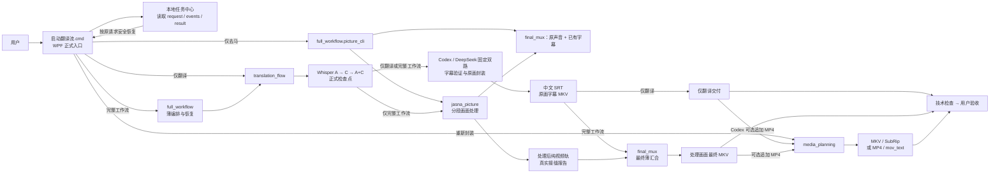
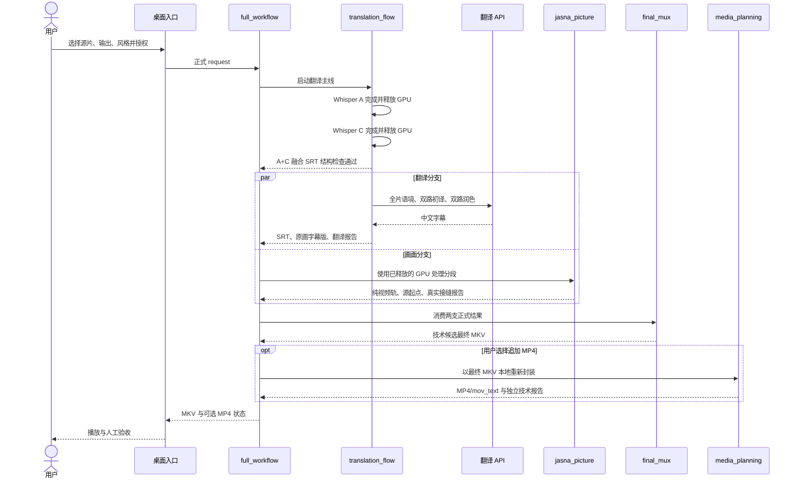

# 项目结构与技术路线

> 本文介绍模块职责、处理顺序、数据接口和运行限制。安装与操作见 [运行手册](WORKFLOW.md)。

### 源码目录

源码按用途分为五个目录：`src/` 保存桌面与 Python 模块，`scripts/` 保存安装及命令行脚本，`tests/` 保存全部离线测试（画面测试在 `tests/picture/`），`config/` 保存配置样例，`docs/` 保存展示图片。根目录的 `启动翻译流.cmd` 是用户入口。

Python 模块名保持不变。桌面入口和 `scripts/python.cmd` 为子进程配置当前源码的 `src` 路径；本机配置、工具、输出和队列按仓库根目录定位，工具默认放在被忽略的 `workflow/tools/`。

### 源码包含的内容

[仓库](https://github.com/escaper74/translation-flow-open)包含源码、界面图片、启动和安装脚本、测试、配置样例、许可证及使用说明；模型、工具安装包、账号凭据、本机配置和用户媒体不随源码发布。新机器需按 README 与 WORKFLOW 安装运行组件，并建立本机验收报告。

## 0. 功能概览

1. 桌面界面：首页为 **去马、翻译、美颜** 三张卡片。前两项直接选择视频，下一页仍可独立或双选去马与翻译，设置保存位置及 MKV/MP4；翻译仍兼容 SRT。美颜直接打开独立播放器。模型、本地工具及已有字幕视频换格式收在右上角设置。
   视频字幕、SRT 与双选任务沿用 **Codex、DeepSeek、Qwen、Kimi、OpenAI、Anthropic、Gemini** 已有后端，不因双选更换服务或模型。
   仅去马通过 `full_workflow.picture_cli` 调用现役 Jasna，再用 `final_mux` 保留原声音与全部已有字幕，输出可播放成品；它不启动 ASR、不调用翻译、不要求登录或 Key。SRT 仅支持精修字幕，选择去马时说明当前输入不适用。
   正式入口支持本地字幕导入检查：内嵌中文轨、匹配文件名的外挂字幕、Windows 中文 OCR 的烧录字幕抽样；发现已有中文字幕便跳过该文件的翻译。去马始终由用户勾选，不自动识别去马痕迹。
2. 完整工作流长期保持“翻译主线”和“画面主线”解耦；A+C 检查点完成后，两支才并行，最后只汇合一次。
3. `full_workflow` 只负责编排和恢复，不复制翻译、画面或封装算法；各模块以正式报告交接。
4. 机器通过只代表技术候选；翻译、画面、同步和播放体验仍由用户验收，结论另写 `human-review.json`。

了解架构可先看第 2–3 节；安装、运行、恢复和排错见 `WORKFLOW.md`。

### 成品、校对与通知

- 顶部“成品”打开本地成品中心：从正式结果读取完整视频，完整工作流与其翻译子任务合并展示；默认优先显示已生成 MP4，其次 MKV，不把纯视频或分段当作成品。支持切换输出目录及查看直接子目录中的正式任务；没有正式记录的散落旧视频不自动归类。
- 每张视频成品卡的播放按钮下方提供“清理中间文件”，仅列该任务的大媒体检查点和逻辑大小。用户看过成片并确认精确路径、数量后才能永久删除；所有完整成片版本、源片、字幕、缓存和日志都保留。清理记录独立落盘，任务中心不再对已清理检查点的任务承诺原地恢复。不是自动删除，也不清理任意外部 ASR 临时目录。
- “字幕校对”并列日文参考和可编辑中文，点击行可定位内置播放器；视频播放依赖本机 Windows 解码支持。另存人工修订 SRT，不覆盖自动原稿；可用原成片视频/音轨 stream-copy 导出新的人工修订 MKV。多字幕轨或非中文轨不自动替换，独立 SRT 可只保存修订。
- 正式后台队列在成功或失败终态请求 Windows 通知，不包含影片名、路径或字幕。关窗后后台仍可发送；Windows 通知设置决定是否显示。通知失败不改变任务结果。
- 对应代码为 `src/translation_flow/library.py`、`src/desktop/TranslationFlowLibrary.ps1`、两个配套 XAML 和 `src/translation_flow/notifications.py`；不改识别、翻译模型、画面算法或既有缓存身份。
- 实时美颜作为独立播放层接入“首页 → 美颜”和“成品 → 美颜播放”，不混入翻译/画面生产任务。独立视频窗内的“美颜”打开可单独移动的小工具窗；关闭工具窗不停止播放、不清空强度，重开继续调节，关闭视频窗时工具窗一起关闭。磨皮、美白、瘦脸、大眼可边看边调或暂停调节；只改变观看画面，不覆盖原片、不生成整部美颜副本。短片预览/前后对比生产功能仍不做。
- 主窗口使用白底与青绿，首页三卡、任务进度卡和内嵌成品卡统一导航；服务、风格和格式以直接选项呈现。任务操作沿用原队列；成品保留播放、版本切换、字幕校对和精确清理确认。缩略图由本机 Windows Shell 异步读取，失败时显示插图，不阻塞界面。入口为 `启动翻译流.cmd`。

验证边界：合成任务与界面测试只覆盖对应交互；实际视频解码、系统通知和观看体验需在使用环境中确认。

### 实时美颜播放层

`beauty_player` 以 Python 标准库启动仅绑定 127.0.0.1、随机地址的单视频服务，WPF 通过现有进程桥打开独立 Edge 播放窗。它不需要登录、Key、字幕外发授权或新生产任务。页面只访问本机资源；跟踪使用本地 MediaPipe Tasks Vision 0.10.21/FaceLandmarker，变形 shader 改编自 GPUPixel，磨皮/肤色为本地 WebGL 实现，不引入未完整开源的 Mars-Face，也不宣称集成了完整 GPUPixel 引擎。

- 浏览器支持的 MP4 直接读源；常见 MKV 经 FFmpeg stream-copy 到内存管道播放，跳转以探测的真实关键帧为锚点，同步字幕和进度。
- 浏览器无法解码 HEVC 时，改用 FFmpeg CPU 实时生成 H.264 观看流（最高 1080p，音轨仍 copy），不保存视频副本。兼容播放会占用额外 CPU；它不是正式转码产物或美颜导出。
- 渲染最多 1080p/两张脸；未检测到稳定人脸显示原画，明显侧脸关闭瘦脸/大眼形变。中文字幕为单独显示层，不被拉伸；第一版播放第一条音轨、首选内嵌中文文本字幕，不做外挂字幕、多音轨选择、HDR 校色或导出。
- 播放验证应覆盖 H.264/MP4、H.264/MKV 和 HEVC 兼容播放、各滑块效果、关闭恢复原画、暂停、跳转和字幕开关。静态人像测试不能代替复杂运动、遮挡、多人镜头的观看验收。运行组件约 22 MiB，置于被 Git 忽略的工具目录；第三方来源及声明见 `src/beauty_player/THIRD_PARTY.txt`。
- 播放 UI 使用奶白、浅紫和葡萄紫；正常状态只显示“实时生效”，不显示人脸数、跟踪或帧率。工具窗为同源独立 popup，播放窗持有本次强度、校验消息来源并同步；弹窗被浏览器策略拦截时明确提示，不退回固定侧栏。视频随窗口自适应，也可只缩放画面（50%–200%），不缩放字幕、播放控件或工具栏；全屏保留播放控制。工具窗不是系统置顶窗口，实际系统窗口管理仍由 Edge/Windows 决定。

## 1. 目标与完成标准

导入日语视频后，可根据所选模式生成：

- 完整中文字幕 SRT；
- 保留原画与原音轨的中文字幕 MKV；
- 可选的画面处理后纯视频轨；
- 画面处理后、保留原音轨并带中文字幕的最终 MKV；
- Codex 原画字幕任务及完整工作流可在正式 MKV 通过后追加一份 MP4/mov_text 软字幕成品；
- 对已带中文字幕的影片，可独立生成 MKV 或 MP4 软字幕版；
- 可审计的阶段事件、检查点和技术报告，以及基于这些正式记录的本地任务中心。

机器负责结构、轨道、时长、可解码性和恢复证据；用户负责翻译自然度、画面质量、接缝、字幕/声音同步和整体观看体验。只有技术检查和用户观看都通过，才能写“最终通过”。

## 2. 架构

### 2.1 功能与运行路径



`media_planning` 是独立的本地重封装旁路，不经过 Whisper、翻译 API 或 Jasna。完整工作流则复用翻译和画面两个独立模块，并在最后一次性汇合。

### 2.2 完整工作流运行时序



A、C 都退出并形成可复用的正式融合检查点之后，翻译 API 和画面分支才并行。任一支失败，另一支继续保留成果；只有两支都通过才进入 `final_mux`。

### 2.3 模块职责与代码入口

| 模块 | 唯一职责 | 首要代码入口 | 正式交付 |
|---|---|---|---|
| 桌面 UI | 构造请求、取得当次授权、启动白名单后端、显示 JSONL 进度/运行摘要/本地任务中心 | `src/desktop/Start-TranslationFlow.ps1`、`src/desktop/TranslationFlowProcessBridge.ps1`、`src/desktop/TranslationFlowUiSummary.ps1`、`src/desktop/TranslationFlowTaskCenter.ps1` | 请求和用户可见状态；不拥有媒体算法 |
| `translation_flow` | A/C 识别、保守融合、外部翻译、字幕验证和原画封装 | `src/translation_flow/cli.py`、`src/translation_flow/runner.py` | 中文 SRT、字幕检查表、原画字幕 MKV、翻译报告 |
| `full_workflow.picture_cli` | 仅去马编排与可播放成品交付，不启动翻译 | `src/full_workflow/picture.py` | 去马 MKV/MP4、原声音、已有字幕和正式报告 |
| `jasna_picture` | 视频分段、Jasna 处理、段级验证、拼接和真实接缝测量 | `src/jasna_picture/cli.py`、`src/jasna_picture/workflow.py` | video-only MKV、画面报告 |
| `final_mux` | 按画面报告映射字幕和原音轨，一次性生成最终成片 | `src/final_mux/cli.py`、`src/final_mux/workflow.py` | 最终 MKV、封装报告 |
| `full_workflow` | 组织 A+C 后双分支、恢复、失败隔离和最终状态 | `src/full_workflow/cli.py`、`src/full_workflow/runner.py` | 顶层 manifest/result；不复制各模块算法 |
| `media_planning` | 按 FFprobe 实际流信息规划并执行已有中文字幕影片重封装 | `src/media_planning/cli.py`、`src/media_planning/runner.py` | MKV/MP4 软字幕版、技术报告 |
| `video_pipeline` | 保留早期画面路线代码，并提供少量共享工具定位能力 | 当前没有桌面正式运行模式 | 不应与 `jasna_picture` 混称为现役画面主线 |
| `workflow/tools` | 保存本机固定工具链 | 各 runner 通过正式配置定位 | FFmpeg、Whisper、Jasna 等本地可执行文件和模型资产 |
| 测试 | 离线契约、真实短媒体和画面独立回归 | `tests/`、`tests/picture/` | 能证明具体行为的回归证据 |

运行数据不写回代码目录：翻译、完整工作流和重新封装分别在输出目录的 `.translation-flow/<job-id>`、`.full-workflow/<job-id>`、`.media-repackage/<job-id>` 留下请求、事件、检查点和报告。正式大媒体产物与这些小型证据分开保存。

### 2.4 容易混淆但实际不同的边界

- `full_workflow` 是调度器，不是第四套翻译或媒体算法。
- `final_mux` 负责“处理后画面 + 原音轨 + 正式 SRT”的最终汇合；`media_planning` 负责“已有中文字幕影片”的容器重封装，两者不是同一路线。
- `video_pipeline` 含历史路线和共享工具定位代码；当前正式画面生产只走 `jasna_picture`，不要把 `scripts/run-video-processing.ps1` 当成第二条现役入口。
- A+C 的 A 是完整条目和时间轴主体，C 常规只提供保守文本候选；新任务在融合交接前可用 C 与本地 VAD 证据校正明确异常的开头前缀，保留原始 A，正文和其余时间不变。C 的数量更多不等于应该替换更多。
- 画面分段是恢复和接缝证据，不是自动提速机制。
- `technical_checks_passed` 只表示机器检查通过；`human-review.json` 才记录用户观看结论。
- 完整工作流追加 MP4 是最终 MKV 之后的交付层：MP4 失败只标记该交付失败，不推翻或删除已经通过的 MKV。
- 安装行为以所使用的代码版本和本机配置为准；其他分支的实现或测试不能代替当前版本验证。

### 2.5 为什么保持两条主线解耦

- 翻译失败不破坏已经完成的画面段；画面失败不使 API、Whisper 和字幕成果失效。
- 画面主线只交付视频轨，不提前混入音频和字幕。
- 最终封装只有一个职责，时间映射只来自画面正式报告。
- 每条主线可以独立短样、恢复、技术验收和用户验收。

## 3. 技术路线

### 3.1 翻译主线

```text
本地预检
→ Whisper A：完整时间轴骨架
→ A 退出并释放 GPU
→ Whisper C：候选文本
→ C 退出并释放 GPU
→ A+C：只接受唯一、可靠的一对一替换
→ 开头局部校时：证据明确才修改，正文及其余时间保持
→ 融合 SRT 再次通过正式结构检查
→ 与画面主线分叉并行
→ 全片语境
→ 固定前后两路分批初译
→ 全部初译验证
→ 固定前后两路第二轮润色
→ 必要时一次假名残留修复
→ 字幕结构硬门
→ 原画/原音轨中文字幕 MKV
```

处理规则：

- A 保留完整条目骨架；C 不删除 A，常规只做保守文本替换。仅新任务应用开头局部校时规则，原识别时间保留在 `A.recognized.ja.srt`，正式 `A.ja.srt` 与 fusion/翻译继续保持一致；旧检查点不追溯改写。
- 不同翻译风格、供应商、模型和源字幕使用独立缓存身份。
- API Key 只在当次进程内使用，不写入请求、缓存、日志、报告或 Git。
- 外部服务只接收字幕文本，音频和视频留在本机。
- 初译和润色各自固定分为连续前后两路，并发为 2；两路不抢批次，润色必须等待全部初译完成。
- 每条字幕必须满足 ID 连续、文本非空且 `end_ms > start_ms`。
- 翻译成功批次立即落盘；同一正式任务只补缺失批。
- 正式字幕、MKV 和技术报告不覆盖已有文件。

### 3.1.1 Codex 字幕接入

新本机任务默认推荐 Codex，使用官方 `codex exec` 与已有 ChatGPT 登录。适配器不读取认证文件、不改变登录或全局配置，不使用私有协议或 API Key 回退。请求身份固定为 `codex / chatgpt.com / cli-default`；`cli-default` 表示不指定 `--model`，实际模型若 CLI 未报告则保持未知。已有 DeepSeek 请求、模型和缓存身份保留。Codex 同时支持仅字幕和双选，桌面保留所选服务与模型。

`translation_flow.translation.codex_provider.CodexProvider` 实现已有 `TranslationProvider.chat(...)` 接口；`codex_runner` 仅编排已有 A+C、独立源文审查、`run_translation` 和封装服务。ID、时间轴、分批和缓存仍由程序控制。CLI 在空临时目录、只读沙箱、忽略用户配置、禁止工具和网页搜索的条件下接收字幕文本；字幕内的命令按引用数据处理。输出正文为 `items[].id/text`，额外 `note` 只进入检查表和审查报告。调用记录只保留版本、模型策略、耗时及 CLI 返回的 usage 等元数据。

源文层保留 A、C、fusion 原件，另写 `reviewed.ja.srt`。先比对 C 的短词重复与重叠 A 文本：样本至少 100 条、同一不超过 4 字符短词占 C 至少 60%、A 支持比例不超过 20% 时，独立参考保守采用 A 全文并报告退化；频繁且受 A 支持的应答不触发降级。正常情况下审计全部 accepted 替换，完全相同及纯格式差异机械记录，其余每批最多 40 条文本复核；疑点进入人工清单，不因此阻止候选交付。不自动扩展音频复听或重跑 ASR，也不把文本判断称为听音确认。

Codex 缓存独立包含适配器/CLI 版本、模型策略、提示、源文本和翻译风格。成功初译、润色及假名修复批次立即落盘。登录失效、额度限制和取消直接停止，无付费 API 回退；连接/输出失败有限重试，本地持久化失败不重复发出调用。ASR 期间停止以约 0.2 秒间隔检查取消并终止本任务拥有的转录子进程树，不等待整个 A/C 阶段；A 的已完成分块保留，被打断分块带未完成标记，恢复时重算，不能仅凭非空字幕复用。CLI 期间停止只终止本任务拥有的 CLI 子进程。完成的 SRT/报告与 MKV 匹配时，恢复或追加 MP4 不再调用 Codex、ASR 或画面服务。

### 3.2 画面主线

画面处理参数：

| 项目 | 设置 |
|---|---|
| 工具 | Jasna v0.10.0 |
| 检测 | `lada-yolo-v4` TensorRT，batch 4 |
| 修复 | BasicVSR++ TensorRT、FP16、clip 90、overlap 8、crossfade |
| 解码 | 必须是 VALI NVDEC 或 PyAV CUDA，软件回退失败 |
| 分段 | 默认约 900 秒，源视频 stream-copy |
| 输出 | HEVC CQ28、Matroska、单视频轨 |
| 拼接 | 完成段 stream-copy concat，不重编码 |

数据流：

```text
只读源片
→ 关键帧边界纯视频分段
→ Jasna 顺序处理
→ 每段输入/输出检查并落报告
→ stream-copy 拼接
→ 总时长、流参数、开头/接缝/结尾抽点解码
→ 完整纯视频轨
```

分段的目标是检查点、恢复和接缝验证，不保证每段精确 900.000 秒，也不天然减少模型总算量。

30 分钟 Gate 用于记录本机技术检查与人工验收的全局路线证据，不是每部新源片的准入证。整片仍硬性要求 Gate 为 `technical_checks_passed`、`scope=acceptance`，且 Jasna 工具版本、检测/修复模型与编码参数符合上述配置。Gate 源片身份与当前源片不同时只记录 informational evidence，不阻断整片，也不表示当前源片已完成逐片 30 分钟人工验收。逐片样片以后是可选质量检查；整片成品仍只能发布为 `candidate_for_human_review`。

### 3.3 最终薄封装

```text
处理后纯视频轨
+ 原片全部原音轨
+ 完整源时间轴中文字幕
→ 按画面报告的真实起点裁切/平移字幕
→ 视频与音频 stream-copy
→ 唯一默认 zho SubRip
→ 轨道、时长和抽点解码检查
```

字幕文本不在这一层修改。顶层不得从文件名、固定 900 秒或解码窗口猜时间轴。

### 3.4 已有中文字幕影片重新封装

这是与翻译和画面主线并列的本地媒体模式：不调用 Whisper、Jasna、DeepSeek 或 GPU，不修改既有接口和检查点。

```text
FFprobe 读取容器与实际 streams
→ 确认唯一可用视频和唯一标记为中文的文本字幕
→ 保留全部原音轨
→ 静态直封规划 + 当前 FFmpeg 极短同参数预检
→ MKV 使用 SubRip，MP4 使用 mov_text
→ 唯一默认 zho 软字幕
→ 轨道、时长和首/中/尾解码检查
```

视频和音频始终 stream-copy；字幕只在容器需要时转为 SubRip 或 mov_text。MP4 不兼容时在正式候选生成前明确停止，提示“需要转码或改用 MKV”；本路线不包含烧录、视频转码或音频转码。容器后缀只用于选择器提示，不作为后端决策依据。

## 4. 稳定数据契约与恢复

### 4.1 源片身份

正式任务使用源路径、文件大小和修改时间绑定检查点。当前不计算整片哈希；只有真实冲突证明现有身份不足时再增加机制。

### 4.2 翻译交接

翻译完成结果必须同时存在并互相匹配：

- 正式中文 SRT；
- 原画字幕 MKV；
- 翻译报告；
- 技术检查报告；
- 源片、翻译风格、供应商和模型身份。

上述条件全部成立时，后续恢复可以不再索取 API Key，也不会重跑 Whisper 或外部翻译。

### 4.3 画面交接

最终画面报告是汇合层唯一时间映射来源，至少包含：

- `source_identity`；
- `source_origin_seconds`；
- `segment_mappings`；
- `output_seam_positions_seconds`；
- 工具、模型、处理参数和段级报告位置。

正常复用要求“完成媒体 + `technical_checks_passed` 报告 + 硬解码证据”。若进程恰好在媒体完成后、报告发布前中断，workflow 允许用成功日志、硬解码证据和重新技术验证自动补建报告：验证通过的 `.working.mkv` 晋升为正式检查点；验证不成立的工作文件改名保留为 `.interrupted-*`，随后自动重跑该段或最终拼接，不删除故障现场。

画面报告同时记录全局路线 Gate 的身份、处理参数和其与当前源片是否同源。不同源是信息性证据，不改写当前源片的源身份，也不将路线级验收冒充为本片人工验收。

### 4.4 失败原则

- 源媒体只读；输出不覆盖源片或已有结果。
- 失败保留现场、日志和已完成检查点，不发布残缺成片。
- 不手改字幕、缓存或报告来伪装自动流成功。
- 修复正式代码并补对应测试后，从同一正式入口恢复。
- 大媒体检查点默认保留；清理由用户查看精确对象后决定。

正式流采用“自动化优先、按影响分级”的处理方式：

- **硬停止：** 源片或 manifest 谱系冲突、命令真实失败、媒体或字幕不可解析、关键轨道缺失、输出会覆盖源片/已有结果、外部调用缺少当次授权或相应登录/Key、翻译阶段 ID/数量/时间码不一致，以及足以说明 ASR 已整体失真的严重重复坍塌。Codex 的 C 短词退化先按 3.1.1 独立降级 A，不改变既有 A/C 硬结构检查。
- **自动修复：** 清理阶段删除不可显示的空文本、零时长或负时长 cue 并写入报告；已完成但未发布报告的画面工作文件经成功日志、硬解码和媒体检查证明后自动晋升；不能证明完整的工作文件保留现场后自动重跑。
- **警告后继续：** cue 间轻微重叠、行数/行长/单条时长等展示问题、少量 cue 超出源时长、可播放的容器时长偏差，以及报告交接中的细小舍入差。警告写入阶段事件和最终结果，供人工观看时定位，但不再为了理论上的完全对齐卡住成片。

容器时长偏差在约 0.5–0.75 秒起提示，2 秒以内仍可交付，超过 2 秒视为可能缺失内容而硬停；画面报告的 origin、段边界和接缝允许 50 ms 内的数值舍入差。真正的翻译 ID/时间轴谱系仍必须逐条一致，因为那是数据归属，不是人眼耳可接受的播放偏差。

## 5. 验证范围

测试目录包含离线协议、检查点恢复、队列生命周期、WPF 控件及短媒体封装测试。离线通过只能证明覆盖到的程序行为；工具和模型路径存在也不代表 GPU、驱动、服务登录或媒体兼容性已通过。

新机器应按 `WORKFLOW.md` 安装组件，先检查环境，再用有权使用的中性素材进行所需模式的短样验证。真实服务调用、GPU 处理与人工观看分别记录结果；不将其他机器或其他素材的报告当作本机通过证明。

## 6. 任务、供应商与后台运行

### 三种处理组合

独立勾选已接到队列、进程入口、进度、停止、恢复与成品页。双选继续 A → C → fusion 后分叉；普通分支失败不停止另一分支，用户停止则在各自安全边界停下。去马以当前段完成为边界，保留已完成段；顶层停止标记同时传给字幕与去马分支。画面核心只输出纯视频轨，原声音与字幕的封装在交付层完成。

仅去马记录位于 `.picture-workflow/<job-id>`，请求没有 provider、profile 或字幕外发 consent。MKV 保留已有软字幕轨与附件，MP4 将文本软字幕转为 mov_text；MP4 无法承载的图形字幕要求改用 MKV，不静默丢弃。字幕任务选择 MP4 时保留已完成的 MKV 检查点。失败封装可从正式入口重试，并保留上次失败 manifest。

### 模型选择与开头局部校时

视频准备页提供“对白识别”的 **Turbo（默认） / large-v3** 选择；C、融合及翻译规则不变，SRT 和仅画面/换格式模式不使用此选项。每个任务按 `asr_a_model` 保存模型并隔离检查点；旧请求未填写该字段仍解释为 large-v3，恢复沿用原模型，不被界面默认值改变。

新视频字幕任务在 A+C 完成后、外部翻译前，利用明确的 C 文本/时间及本地 VAD 证据校正异常开头。它不启用全片 VAD 重识别、不整体平移、不改变融合文本选择；组件缺失或证据不足时保留原时间。已完成任务和旧的部分检查点按原规则恢复。具体规则见 `WORKFLOW.md` 第 9 节。

### 桌面摘要、任务中心与追加 MP4

桌面按后端事件汇总总耗时和已完成阶段耗时，显示正式检查点是本次运行还是复用。失败页保留原始错误日志，并显示失败阶段、已保留成果和恢复建议。界面摘要不改写技术报告。

任务中心读取所选输出目录的正式 request、events、result、manifest 和技术报告，列出历史任务与已有产物；不新建第二份数据库，不扫描未选择的磁盘。按原请求继续会还原源片、输出目录、风格、供应商/模型、模式和交付偏好，沿用稳定 job id 与当次授权规则。API Key 不进入历史记录。

完整工作流的可选 MP4 在正式 MKV 后调用 `media_planning` 生成：视频和全部原音轨 stream-copy，字幕转为唯一默认 `zho` mov_text。失败单独记录，不改变已通过的 MKV。旧 request 没有 `delivery` 字段时等价于不追加 MP4；追加偏好不进入核心谱系，已完成任务可只补交 MP4。

### 媒体输入与供应商

ASR 前通过 FFprobe 读取实际容器/轨道，并用 FFmpeg 做首条音轨短解码和视频/全部音轨的短 MKV 直封检查。失败时不进入 ASR 或翻译。输入是否可用由实际工具决定，不能仅凭文件后缀；原画翻译支持的编码也不等于画面引擎支持。

新 ASR 任务的 A、C 都识别首条音轨，原画成片保留全部原音轨。旧 `asr.input.json` 没有选轨记录时沿用旧策略，完成检查点直接复用。选轨、编码、检查和提醒写入 `asr/media-input.report.json`。

SRT、视频翻译和完整流程共用 DeepSeek、Qwen、Kimi、OpenAI、Anthropic、Gemini、Codex 适配层。Codex 使用官方 CLI 与本机 ChatGPT 登录；六家 API 使用各自的官方端点和当次 Key。

- DeepSeek 保留原模型、参数和缓存身份；其他五家须明确指定模型 ID。
- Qwen/Kimi/Gemini 使用 Chat Completions 文本协议，OpenAI 使用 Responses（`store=false`），Anthropic 使用 Messages；适配器不新增 SDK 依赖。
- API Key 仅从本次进程环境取得；授权必须匹配供应商。缓存按供应商、端点、模型、输出上限和翻译选项隔离，Key 不参与身份。
- 完成字幕而封装失败时可无 Key 补封装；完整产物和报告匹配时不重跑 ASR/API。改变供应商、端点、模型或输出上限须另建任务。
- 离线协议测试不能证明每家服务、每个模型的连通、限流、参数兼容或译文质量；需要相应的授权小样确认。

独立 SRT 桌面入口 `translation_flow.srt_desktop` 将 request/events 对接既有翻译 CLI，记录位于 `.srt-translation/<job-id>`。输出中文 SRT 和结构/疑点报告，不声称完成视频源文审查。失败或停止保留批次，恢复核对源文、配置及结果；已完成且匹配的任务可直接复用。

### 队列与后台运行

`translation_flow.task_queue`、`translation_flow.queue_cli` 与 `src/desktop/TranslationFlowQueueBridge.ps1` 提供顺序批量、停止保留进度和关窗后后台运行。请求身份、翻译缓存和模块接口保持一致。

后台独立于窗口存活，只顺序启动任务；重复入队不重复运行，失败项保留但不挡后续项。成功须有当前运行的完成事件、正式报告和实际产物；窗口重连读取同一队列。无法解析的批量请求单独返回原因，其余项正常入队。

API Key 只在后台内存和本次子进程环境中。同一后台内暂停、停止或失败后可复用本次 Key，成功后释放；后台重启后等待项暂停并要求重新授权。仍存活的原子进程按 PID 与创建身份继续跟踪，不重复启动。OS 租约用于防止窗口重开或后台崩溃后的重复执行，不增加媒体检查点。

进度估算只使用同阶段的已完成数量和事件时间；数据不足时明确等待，不把总百分比换算为整项任务倒计时。具体协议和操作见 `WORKFLOW.md` 1.3。

## 7. 文档与许可

- [README](README.md)：功能概览与快速开始。
- [运行手册](WORKFLOW.md)：组件安装、操作命令、恢复、验证与排错。
- [配置样例](config/local.example.psd1)：本地路径配置。
- [第三方声明](THIRD_PARTY_NOTICES.txt)：依赖来源、许可证与分发要求。

### 许可证

本项目采用 Apache-2.0，完整条款见根级 `LICENSE`，授权范围包括本项目代码、文档及自行生成的首页插图；已有第三方版权和修改声明继续保留。外部 Jasna、FFmpeg、NVIDIA 组件和模型的许可需分别满足，不能用项目许可证覆盖。

首页插图 `src/desktop/assets/feature-art.png` 由本项目生成，适用本项目许可证。第三方资源的具体归属见 `THIRD_PARTY_NOTICES.txt`。
