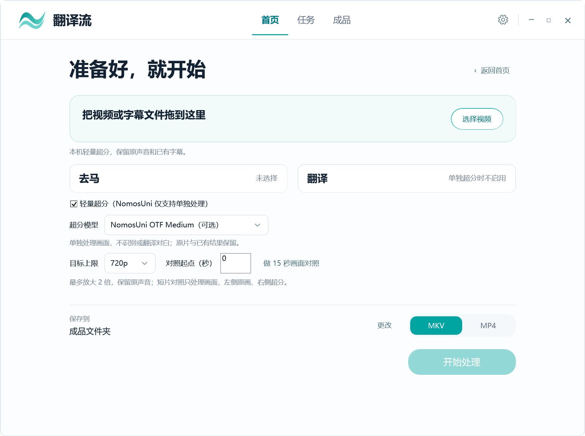
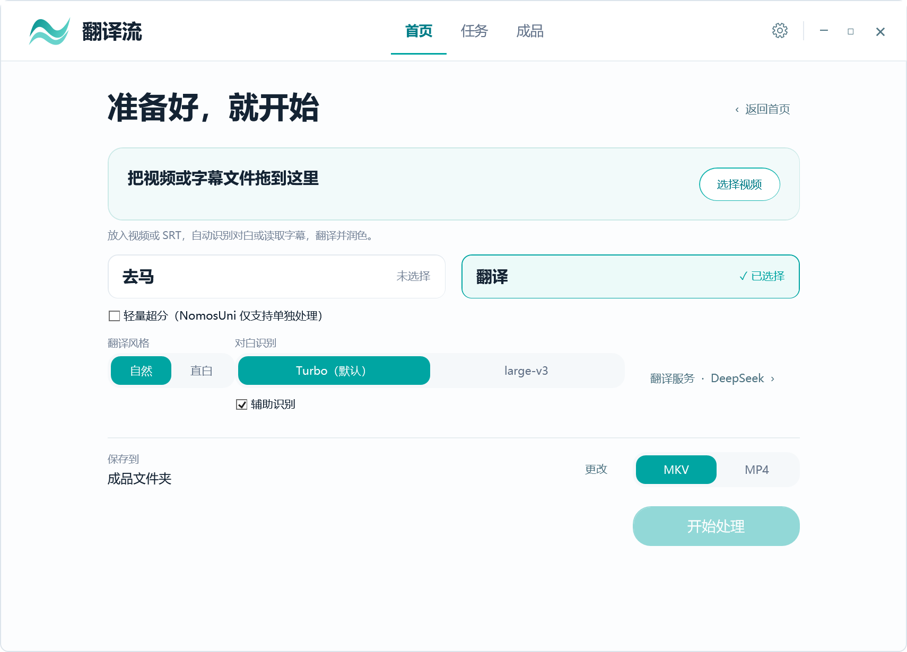

<h1 align="center">翻译流</h1>

<p align="center">给日语视频加上中文字幕，也能轻量超分、去马和边看边调美颜。</p>

<p align="center">
  <a href="#本次更新--20261105">本次更新</a> ·
  <a href="#rtx-4080-laptop-处理时间参考">处理时间</a> ·
  <a href="#开始使用">开始使用</a> ·
  <a href="WORKFLOW.md#新机器安装">安装指南</a> ·
  <a href="#使用说明">使用说明</a>
</p>


<small>本版首页，直接从当前桌面界面文件导出。</small>

## 能做什么

- **翻译** — 导入视频或日文 SRT，生成中文字幕；视频可保存为 MKV 或 MP4，保留原声音。
- **去马** — 单独处理画面，也能和翻译一起做。画面由模型推断，效果需要试看。
- **超分** — 可单独处理老片，保留原声音与已有字幕；Lite 也可和翻译组合，支持先做 15 秒左右对照。
- **美颜** — 边看边调磨皮、美白、瘦脸和大眼，只改变观看效果。

支持批量添加和中断后继续。做完后，在「成品」里播放、校对字幕、另存修订版或清理中间文件。

## 本次更新 · 2026.11.05

这次主要补上了三件事：**老片可以单独超分、辅助识别可以一键开关、处理进度能看懂了。** 同时修复了部分老格式视频的字幕时间偏移，并补齐新用户的超分安装入口。

### 1. 老片也能单独超分，先看 15 秒再决定

首页新增 **「单独超分」**。已经有字幕、只想改善低清画面的老片，可以直接放进来处理，原声音和已有字幕一起保留，完成后另存一份视频。

提供 **720p / 1080p** 两档目标上限，最多放大两倍。这项功能主要给低分辨率素材多一个选择：比如本次实际把一部约 89 分钟、720×404 的老片处理成了 1284×720。

| 模型 | 怎么选 |
|---|---|
| **Upscayl Lite（默认）** | 可以单独超分，也可以勾选「翻译 + 轻量超分」，一次生成带中文字幕的超分视频。 |
| **NomosUni OTF Medium（可选）** | 本轮对照中选出的另一种画面效果，已接入单独超分。已有字幕或已经翻译好的片子，可直接用它处理。 |

不必上来就跑整部：填写想看的时间点，点击 **「做 15 秒画面对照」**，输出左边原画、右边超分的短片，看看人物、线条和纹理是否合口味。超分默认关闭，模型默认仍为 Lite；NomosUni 在下拉框里手动选。

<details>
<summary>展开看本版超分设置：NomosUni、720p 与 15 秒对照</summary>



</details>

### 2. 辅助识别变成一个开关，文本检查只抓明显重复

视频翻译页现在直接显示 **「对白识别」** 和 **「辅助识别」**，不用先弄懂 A、C 是什么：

- **勾选辅助识别**：多识别一遍，结合两份结果整理字幕。默认保持开启。
- **取消勾选**：只做一遍主识别，省去辅助识别的时间和组件。主识别仍可选 Turbo 或 large-v3，默认 Turbo。

两种模式之后都会清理明显的重复幻觉，例如某个短句被识别器反复铺满一段。AI 只看筛出的重复候选，明确是错误才删除，拿不准的留下，然后继续翻译和润色。检查服务偶发没返回可用结果时，保留字幕继续；这一步不会变成逐句反复审查的关卡。

<details>
<summary>展开看本版翻译设置：Turbo、辅助识别与翻译服务</summary>



</details>

### 3. 现在能看见究竟处理到哪一步

识别、翻译和画面各自显示自己的进度，任务卡、详情页和队列使用同一份计数。重新打开界面后，也能继续看到已经完成的部分。

| 正在做什么 | 现在怎么看 |
|---|---|
| 识别对白 | 已识别的音频段数 / 总段数 |
| 翻译字幕 | 累计完成的字幕数，进入下一批时接着计数 |
| 画面处理 | 已完成几段 / 共几段，不会被同时进行的翻译覆盖 |
| 轻量超分 | 已处理帧数 / 总帧数 |
| 分段处理完毕 | 显示「拼接与检查」，生成完整成片后再显示完成 |

例如画面走到 `12/12`，接下来就是把这些段拼起来、保留声音并保存成片；这段等待现在也有对应的状态。

### 4. 修复老格式视频的时间偏移，安装按需准备

- **部分 WMV / ASF 的字幕对齐修复**：修正分段提取识别音频时的起点偏移，让对白回到原片的时间线上。新任务使用修正后的分段方式。
- **美颜播放兼容性修复**：修正共享工具目录的查找，以及 10-bit HEVC 视频的播放兼容问题。
- **超分有独立安装入口**：双击根目录的 `安装轻量超分.cmd`，即可准备 Lite 和 NomosUni 所需组件。单独超分不需要识别模型或翻译账号；关闭辅助识别的翻译任务也不需要安装 C。
- **下载说明补齐**：安装手册给出固定版本的工具、模型入口和放置位置，FFmpeg 下载地址也已更新。

## RTX 4080 Laptop 处理时间参考

下面是 **RTX 4080 Laptop GPU（12 GB 显存）** 上的实际记录。把片长、分辨率和所选功能放在一起，方便安排一轮任务要留多久；这些时间作为参考。

| 做什么 | 素材与设置 | 实际用时 |
|---|---|---:|
| **整片单独超分** | 约 89 分钟，720×404 → 1284×720；NomosUni OTF Medium，保留原声音和字幕 | **约 2 小时 9 分** |
| **整片翻译 + 画面处理** | 约 145 分钟，1080p；Turbo + 辅助识别，DeepSeek API，含最终封装 | **约 1 小时 21 分** |
| **只看主识别这一阶段** | 约 116 分钟视频；Turbo，关闭辅助识别 | **约 11 分 20 秒** |

第二项中，字幕部分约 **57 分钟**完成，画面处理同时进行，约 **81 分钟**得到最终成片。两条流程重叠的时间不用相加。

同一段 **2 分钟、约 30 fps、720×404 → 1284×720** 的短片对照：

| 超分模型与本版批次设置 | 含编码、音轨封装的用时 |
|---|---:|
| Lite，64 帧一批 | **4 分 22 秒** |
| NomosUni OTF Medium，256 帧一批 | **2 分 36 秒** |

两分钟数据和整片数据分别列出，看片段速度也看整片实际花费。更详细的识别、翻译、画面耗时见 [处理时间记录](docs/performance.md)。

## 开始使用

目前提供源码，适用于 **Windows 11 x64 / Python 3.12 x64**。本项目的视频识别和去马配置需要 NVIDIA 显卡；单独超分使用 Vulkan，不依赖 CUDA，本机验证为 NVIDIA，其他显卡仍需实测。工具与模型按功能安装，不需要全装。

1. 下载并解压源码，按下方「首次安装」准备 Python；视频组件见[安装指南](WORKFLOW.md#新机器安装)。
2. 双击 **`启动翻译流.cmd`**。需要翻译时，选择服务并登录或填写 Key。
3. 选择视频或 SRT，确认功能和保存位置，点击「开始处理」。

音视频留在本机；翻译会把字幕文本发送给所选服务，使用你自己的账号和额度。

<details>
<summary>首次安装：Python 与翻译服务</summary>

安装 [Python 3.12 x64](https://www.python.org/downloads/windows/)，把源码解压到可写目录，例如 `C:\TranslationFlow`。在这个目录打开 PowerShell：

```powershell
py -3.12 -m venv .venv
Copy-Item .\config\local.example.psd1 .\config\local.psd1
```

桌面入口会自动找到 `.venv`。使用其他位置的 Python 时，在 `config/local.psd1` 填写 `PythonPath`。

**选择翻译服务**

可选 Codex、DeepSeek、Qwen、Kimi、OpenAI、Anthropic 或 Gemini。

使用 Codex 时，先按[官方说明](https://learn.chatgpt.com/docs/codex/cli)安装 CLI，再运行 `codex login`；API 方式在界面填写所选服务的 Key。已有日文字幕的话，可以先用一小段 SRT 试一下。开始前的服务连接检查会使用少量账户额度。

**安装视频组件**

按功能准备：

| 使用方式 | 需要的组件 |
|---|---|
| 只翻译已有 SRT | Python + 所选翻译服务 |
| 视频翻译，关闭「辅助识别」 | 再加 FFmpeg + Whisper A + A 模型 |
| 视频翻译，开启「辅助识别」（默认） | 再加 C 环境及 C 模型 |
| 单独超分 | Python + FFmpeg + 超分组件，无需 Whisper/C/翻译账号 |
| 去马 | Python + FFmpeg + Jasna 及本机 TensorRT 引擎 |

超分组件双击 **`安装轻量超分.cmd`** 准备；代码和安装说明都在源码里，模型、工具另行下载。FFmpeg 使用[固定 8.1.1 发布包](https://github.com/GyanD/codexffmpeg/releases/tag/8.1.1)，其他版本、目录和手工安装方式见[安装指南](WORKFLOW.md#新机器安装)。美颜可单独安装。需要试看时可先处理短片，普通任务不要求历史验收报告。

</details>

## 使用说明

<details>
<summary>检查本地环境</summary>

在源码目录运行，`provider` 换成你使用的服务：

```powershell
# 检查桌面能否加载
powershell.exe -NoProfile -STA -ExecutionPolicy Bypass -File .\src\desktop\Start-TranslationFlow.ps1 -ValidateOnly

# 检查字幕翻译所需的本地路径
.\scripts\python.cmd -m translation_flow.diagnostics --mode srt --provider deepseek

# 检查视频组件
.\scripts\python.cmd -m translation_flow.diagnostics --mode video --provider codex
```

关闭辅助识别时加上 `--asr-mode a_only`，不再检查 C；选择 large-v3 时加上 `--asr-a-model large-v3`。`missing_paths` 会列出缺少的文件。这些命令不运行模型或翻译；路径检查通过后，仍需在开始任务时确认服务和运行环境可用。

</details>

<details>
<summary>常见问题</summary>

**提示找不到 Python、FFmpeg 或模型**

展开上面的「检查本地环境」，按缺失路径补齐组件。如果工具放在其他盘，在 `config/local.psd1` 配置对应路径；字段说明见[配置样例](config/local.example.psd1)。

**翻译中断了，或者重开后任务暂停**

检查所选服务的登录、网络和额度，再到「任务」页点继续。重开程序后，可能需要重新填写 Key 并确认继续翻译；已完成的步骤会尽量复用。需要更换模型时，新建任务即可。

**为什么关闭窗口后还在处理？**

窗口关闭后，后台队列会继续工作。想暂停处理时，先在任务里点「停止」，等状态更新后再关窗口。

**去马提示缺少引擎或验收报告**

Jasna 首次使用需要为本机显卡生成引擎，并完成样片检查。使用设置里的“首次画面验证：选择短视频”，或按[短样验证说明](WORKFLOW.md#首次画面短样验证)从长视频抽取样片。普通任务不需要 `AcceptanceGateReport`。

**处理完以后，怎么腾出硬盘空间？**

先确认成片能正常观看，再点成品卡上的「清理中间文件」。程序会列出待删除的文件，完整成片、字幕和日志会保留。清掉的中间分段无法再用于恢复任务。

**字幕有错，或者声音和字幕对不上**

文字可以在「成品 → 字幕校对」中修改，保存后另存修订成片。遇到时间偏移或处理错误时，保留任务日志，反馈输入类型、处理选项和出现问题的位置，便于排查。

</details>

<details>
<summary>开发说明</summary>

[项目结构](PROJECT_BRIEF.md) · [运行手册](WORKFLOW.md) · [开发约定](AGENTS.md)

在源码目录运行测试：

```powershell
.\scripts\python.cmd -m unittest discover -s tests -t . -q
```

部分集成测试需要相应的本地工具。依赖要求与验证方法见运行手册。

</details>

---

[Apache-2.0](LICENSE) · 第三方工具、模型及引用代码的许可见[第三方声明](THIRD_PARTY_NOTICES.txt)。
