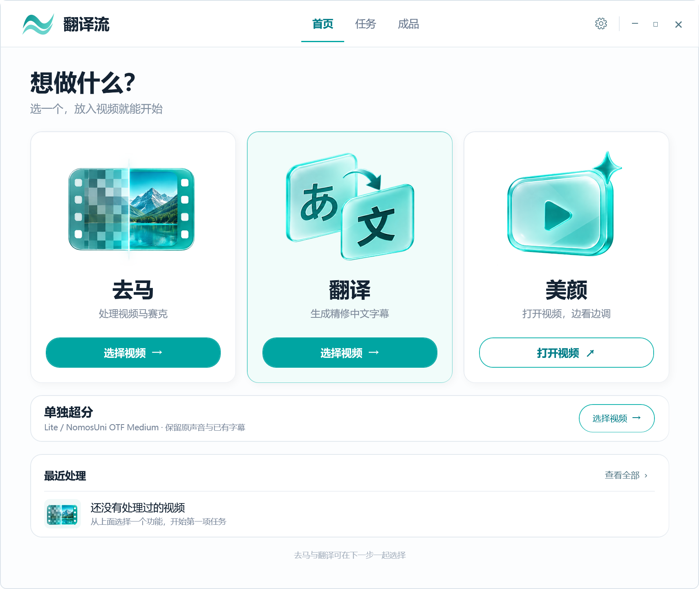

<h1 align="center">翻译流</h1>

<p align="center">给日语视频加上中文字幕，也能轻量超分、去马和边看边调美颜。</p>

<p align="center">
  <a href="#开始使用">开始使用</a> ·
  <a href="WORKFLOW.md#新机器安装">安装指南</a> ·
  <a href="#使用说明">使用说明</a>
</p>



<small>上图为上一版界面；本版另增「单独超分」入口。</small>

## 能做什么

- **翻译** — 导入视频或日文 SRT，生成中文字幕；视频可保存为 MKV 或 MP4，保留原声音。
- **去马** — 单独处理画面，也能和翻译一起做。画面由模型推断，效果需要试看。
- **超分** — 可单独处理老片，保留原声音与已有字幕；Lite 也可和翻译组合，支持先做 15 秒左右对照。
- **美颜** — 边看边调磨皮、美白、瘦脸和大眼，只改变观看效果。

支持批量添加和中断后继续。做完后，在「成品」里播放、校对字幕、另存修订版或清理中间文件。

## 本次更新 · 2026.11.05

- 「辅助识别」可关闭，省去第二遍识别；默认仍开启。两种模式都只清理明显的重复幻觉，拿不准的保留，检查无结论时继续。
- 「识别对白」显示已完成的音频段，「画面处理」显示已完成段数；分段全部完成后还会拼接与检查，翻译下一批不再把进度清零。
- 可选轻量超分：默认 Lite，NomosUni OTF Medium 可用于单独超分；720p / 1080p 上限，最多放大两倍。超分默认关闭。
- 修复部分 WMV/ASF 的识别音频时间偏移，并隔离旧分段缓存；保留上一版兼容性与恢复修复。

本机已完成单独超分、Codex + 关闭辅助识别、DeepSeek API + 开启辅助识别的真实流程。仍可能有少量重复短句或识别误差；查看[运行与安装说明](WORKFLOW.md)，确认所需组件后再处理自己的素材。

## 开始使用

目前提供源码，适用于 **Windows 11 x64 / Python 3.12 x64**。本项目的视频识别和去马配置需要 NVIDIA 显卡；单独超分使用 Vulkan，不依赖 CUDA，本机验证为 NVIDIA，其他显卡仍需实测。工具与模型按功能安装，不需要全装。

1. 下载并解压源码，按下方「首次安装」准备 Python；视频组件见[安装指南](WORKFLOW.md#新机器安装)。
2. 双击 **`启动翻译流.cmd`**。需要翻译时，选择服务并登录或填写 Key。
3. 选择视频或 SRT，确认功能和保存位置，点击「开始处理」。

音视频留在本机；翻译会把字幕文本发送给所选服务，使用你自己的账号和额度。

<details>
<summary>首次安装：Python 与翻译服务</summary>

安装 [Python 3.12 x64](https://www.python.org/downloads/windows/)，把源码解压到可写目录，例如 `C:\TranslationFlow`。在这个目录打开 PowerShell：

```powershell
py -3.12 -m venv .venv
Copy-Item .\config\local.example.psd1 .\config\local.psd1
```

桌面入口会自动找到 `.venv`。使用其他位置的 Python 时，在 `config/local.psd1` 填写 `PythonPath`。

**选择翻译服务**

可选 Codex、DeepSeek、Qwen、Kimi、OpenAI、Anthropic 或 Gemini。

使用 Codex 时，先按[官方说明](https://learn.chatgpt.com/docs/codex/cli)安装 CLI，再运行 `codex login`；API 方式在界面填写所选服务的 Key。已有日文字幕的话，可以先用一小段 SRT 试一下。开始前的服务连接检查会使用少量账户额度。

**安装视频组件**

按功能准备：

| 使用方式 | 需要的组件 |
|---|---|
| 只翻译已有 SRT | Python + 所选翻译服务 |
| 视频翻译，关闭「辅助识别」 | 再加 FFmpeg + Whisper A + A 模型 |
| 视频翻译，开启「辅助识别」（默认） | 再加 C 环境及 C 模型 |
| 单独超分 | Python + FFmpeg + 超分组件，无需 Whisper/C/翻译账号 |
| 去马 | Python + FFmpeg + Jasna 及本机 TensorRT 引擎 |

超分组件双击 **`安装轻量超分.cmd`** 准备；代码和安装说明都在源码里，模型、工具另行下载。FFmpeg 使用[固定 8.1.1 发布包](https://github.com/GyanD/codexffmpeg/releases/tag/8.1.1)，其他版本、目录和手工安装方式见[安装指南](WORKFLOW.md#新机器安装)。美颜可单独安装。需要试看时可先处理短片，普通任务不要求历史验收报告。

</details>

## 使用说明

<details>
<summary>检查本地环境</summary>

在源码目录运行，`provider` 换成你使用的服务：

```powershell
# 检查桌面能否加载
powershell.exe -NoProfile -STA -ExecutionPolicy Bypass -File .\src\desktop\Start-TranslationFlow.ps1 -ValidateOnly

# 检查字幕翻译所需的本地路径
.\scripts\python.cmd -m translation_flow.diagnostics --mode srt --provider deepseek

# 检查视频组件
.\scripts\python.cmd -m translation_flow.diagnostics --mode video --provider codex
```

关闭辅助识别时加上 `--asr-mode a_only`，不再检查 C；选择 large-v3 时加上 `--asr-a-model large-v3`。`missing_paths` 会列出缺少的文件。这些命令不运行模型或翻译；路径检查通过后，仍需在开始任务时确认服务和运行环境可用。

</details>

<details>
<summary>常见问题</summary>

**提示找不到 Python、FFmpeg 或模型**

展开上面的「检查本地环境」，按缺失路径补齐组件。如果工具放在其他盘，在 `config/local.psd1` 配置对应路径；字段说明见[配置样例](config/local.example.psd1)。

**翻译中断了，或者重开后任务暂停**

检查所选服务的登录、网络和额度，再到「任务」页点继续。重开程序后，可能需要重新填写 Key 并确认继续翻译；已完成的步骤会尽量复用。需要更换模型时，新建任务即可。

**为什么关闭窗口后还在处理？**

窗口关闭后，后台队列会继续工作。想暂停处理时，先在任务里点「停止」，等状态更新后再关窗口。

**去马提示缺少引擎或验收报告**

Jasna 首次使用需要为本机显卡生成引擎，并完成样片检查。使用设置里的“首次画面验证：选择短视频”，或按[短样验证说明](WORKFLOW.md#首次画面短样验证)从长视频抽取样片。普通任务不需要 `AcceptanceGateReport`。

**处理完以后，怎么腾出硬盘空间？**

先确认成片能正常观看，再点成品卡上的「清理中间文件」。程序会列出待删除的文件，完整成片、字幕和日志会保留。清掉的中间分段无法再用于恢复任务。

**字幕有错，或者声音和字幕对不上**

文字可以在「成品 → 字幕校对」中修改，保存后另存修订成片。遇到时间偏移或处理错误时，保留任务日志，反馈输入类型、处理选项和出现问题的位置，便于排查。

</details>

<details>
<summary>开发说明</summary>

[项目结构](PROJECT_BRIEF.md) · [运行手册](WORKFLOW.md) · [开发约定](AGENTS.md)

在源码目录运行测试：

```powershell
.\scripts\python.cmd -m unittest discover -s tests -t . -q
```

部分集成测试需要相应的本地工具。依赖要求与验证方法见运行手册。

</details>

---

[Apache-2.0](LICENSE) · 第三方工具、模型及引用代码的许可见[第三方声明](THIRD_PARTY_NOTICES.txt)。
