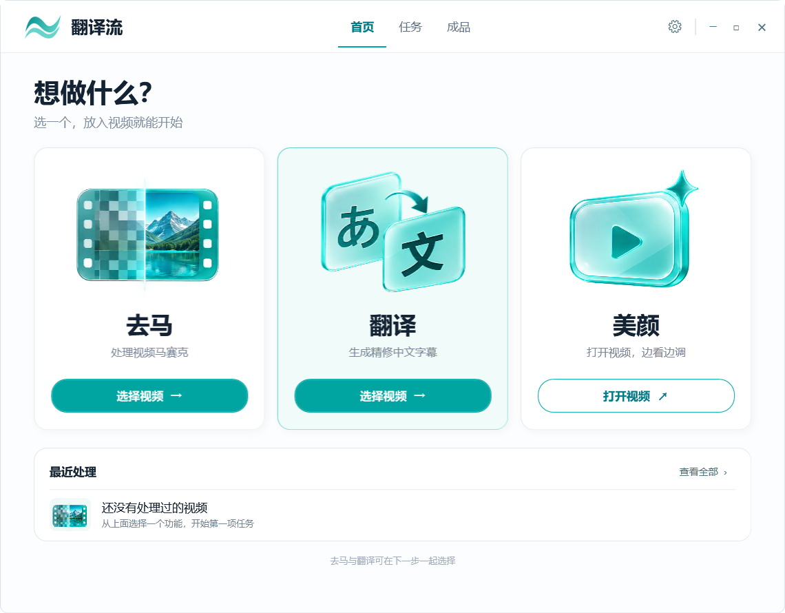

# 翻译流

给日语视频加上中文字幕，也能去马、边看边调美颜。

[开始使用](#开始使用) · [安装视频组件](WORKFLOW.md#新机器安装) · [常见问题](#常见问题)



## 能做什么

- **翻译视频或字幕。** 导入日语视频或日文 SRT，生成中文字幕；视频可保存为 MKV 或 MP4，保留原声音。
- **去马。** 使用本地 Jasna 处理画面，可单独使用，也可和翻译一起做。结果是模型推断的画面，效果需要试看。
- **边看边调美颜。** 播放时调整磨皮、美白、瘦脸和大眼，只改变观看效果。
- **批量处理和字幕校对。** 一次添加多部视频，中途停止后可以继续。做完后在「成品」里播放、改字幕、另存修订版或清理中间文件。

已有字幕的视频，也可以在设置里单独换格式。音视频处理留在本机；翻译会把字幕文本发送给所选服务，使用你自己的账号和额度。

## 开始使用

目前提供源码。桌面版使用 **Windows 11 x64、Python 3.12 x64**；视频识别和去马当前使用 NVIDIA CUDA 路线。工具与模型需要另外下载。

**1. 准备 Python 环境**

安装 [Python 3.12](https://www.python.org/downloads/windows/)，把源码解压到可写目录，例如 `C:\TranslationFlow`。在这个目录打开 PowerShell：

```powershell
py -3.12 -m venv .venv
Copy-Item .\config\local.example.psd1 .\config\local.psd1
```

桌面入口会自动找到 `.venv`。使用其他位置的 Python 时，在 `config/local.psd1` 填写 `PythonPath`。

**2. 打开程序，选好翻译服务**

双击 **`启动翻译流.cmd`**。可选 Codex、DeepSeek、Qwen、Kimi、OpenAI、Anthropic 或 Gemini。

使用 Codex 时，先按[官方说明](https://learn.chatgpt.com/docs/codex/cli)安装 CLI，再运行 `codex login`；API 方式在界面填写所选服务的 Key。已有日文字幕的话，可以先用一小段 SRT 试一下。开始前的服务连接检查会使用少量账户额度。

**3. 按需安装视频组件**

视频需要 FFmpeg 和 Whisper 识别组件，版本、下载来源和放置目录见[安装说明](WORKFLOW.md#新机器安装)。去马还需 Jasna、本机生成的 TensorRT 引擎，以及短样和 30 分钟样片检查；美颜组件可以单独安装。

准备好后，选视频、勾选功能和保存位置，点击「开始处理」。翻译完成后，可以在「成品 → 字幕校对」边看边改，另存修订版。

<details>
<summary>检查本地环境</summary>

在源码目录运行，`provider` 换成你使用的服务：

```powershell
# 检查桌面能否加载
powershell.exe -NoProfile -STA -ExecutionPolicy Bypass -File .\desktop\Start-TranslationFlow.ps1 -ValidateOnly

# 检查字幕翻译所需的本地路径
.\.venv\Scripts\python.exe -m translation_flow.diagnostics --mode srt --provider deepseek

# 检查视频组件
.\.venv\Scripts\python.exe -m translation_flow.diagnostics --mode video --provider codex
```

选择 large-v3 时，在视频检查命令后加上 `--asr-a-model large-v3`。`missing_paths` 会列出缺少的文件。这些命令不运行模型或翻译；路径检查通过后，仍需在开始任务时确认服务和运行环境可用。

</details>

## 常见问题

<details>
<summary>提示找不到 Python、FFmpeg 或模型</summary>

展开上面的「检查本地环境」，按缺失路径补齐组件。如果工具放在其他盘，在 `config/local.psd1` 配置对应路径；字段说明见[配置样例](config/local.example.psd1)。

</details>

<details>
<summary>翻译中断了，或者重开后任务暂停</summary>

检查所选服务的登录、网络和额度，再到「任务」页点继续。重开程序后，可能需要重新填写 Key 并确认继续翻译；已完成的步骤会尽量复用。需要更换模型时，新建任务即可。

</details>

<details>
<summary>为什么关闭窗口后还在处理？</summary>

窗口关闭后，后台队列会继续工作。想暂停处理时，先在任务里点「停止」，等状态更新后再关窗口。

</details>

<details>
<summary>去马提示缺少引擎或验收报告</summary>

Jasna 首次使用需要为本机显卡生成引擎，并完成样片检查。按[安装说明](WORKFLOW.md#在新机器建立画面验收报告)走完后，将生成的报告路径填入 `AcceptanceGateReport`。

</details>

<details>
<summary>处理完以后，怎么腾出硬盘空间？</summary>

先确认成片能正常观看，再点成品卡上的「清理中间文件」。程序会列出待删除的文件，完整成片、字幕和日志会保留。清掉的中间分段无法再用于恢复任务。

</details>

<details>
<summary>字幕有错，或者声音和字幕对不上</summary>

文字可以在「成品 → 字幕校对」中修改，保存后另存修订成片。遇到时间偏移或处理错误时，保留任务日志，反馈输入类型、处理选项和出现问题的位置，便于排查。

</details>

## 开发与许可

实现和模块说明见 [PROJECT_BRIEF](PROJECT_BRIEF.md)，安装与运行步骤见 [WORKFLOW](WORKFLOW.md)，协作约定见 [AGENTS](AGENTS.md)。

<details>
<summary>运行测试</summary>

```powershell
python -m unittest discover -s tests -q
python -m unittest discover -s tests_jasna_picture -q
```

部分集成测试需要相应的本地工具。现有测试环境和样片记录见运行手册。

</details>

本项目采用 [Apache-2.0](LICENSE)。第三方工具、模型及引用代码遵循各自的许可，详见 [THIRD_PARTY_NOTICES](THIRD_PARTY_NOTICES.txt)。
